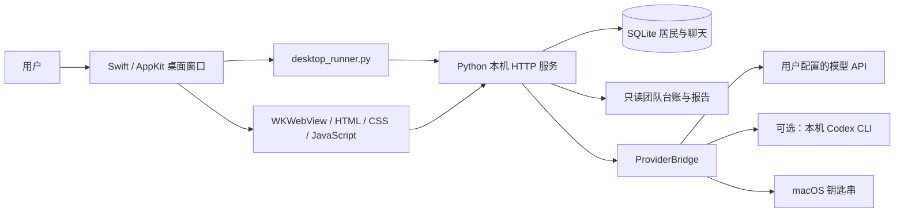

# 星栖小镇架构

星栖小镇是一款本机运行的像素智能体应用。日常产品形态是桌面版（macOS 原生窗口，Windows WebView2 窗口）：角色资料和聊天记录由本机应用管理；AI 回复来自用户自己选择的模型服务。仓库中的 HTTP 服务与网页资源是桌面内嵌实现，并供测试与构建使用，不再作为独立浏览器产品入口。

## 运行结构



桌面版的 Python 解释器和标准库随应用一起发布，用户无需另装 Python、Node.js 或 Codex。构建者需要准备可重定位的 Python 运行时和 Xcode 命令行工具；构建依赖不等于最终用户依赖。源码方式需要 Python 3.9 或更新版本。

原生窗口使用 macOS 自带的 AppKit 和 WebKit，没有 Electron 或远程网页依赖。后端使用 Python 标准库、SQLite 和 `urllib`，目前无需安装第三方 Python 包。地图、人物和图标使用项目内的 SVG，界面与皮肤使用本地 CSS。

## 主要文件

| 文件或目录 | 职责 |
| --- | --- |
| `desktop/App.swift` | 原生窗口、菜单、后台进程生命周期、团队目录选择与导航约束 |
| `desktop/Installer.swift` | 安装与更新应用，创建桌面入口 |
| `desktop_runner.py` | 启动私有服务、报告启动结果、跟随桌面进程退出、显式迁移旧数据 |
| `server.py` | 本机 HTTP API、输入校验、居民与聊天持久化、任务状态和团队数据读取 |
| `provider_bridge.py` | 选择 Codex 或用户模型 API，保存公开连接配置，限制连接与回复 |
| `credential_store.py` | macOS 钥匙串访问；非桌面调试场景可读环境变量密钥 |
| `model_bridge.py` | 可选的本机 Codex 文本对话连接，关闭工具和外部执行能力 |
| `web/` | 小镇、角色、聊天、任务板、成长册与设置页面 |
| `web/skins/` | 皮肤清单、样式与新皮肤模板 |
| `desktop/windows_app.py` | Windows 桌面壳：拉起后端、单实例、WebView2 窗口 |
| `scripts/build_macos.py` | 组装 macOS 应用与内置运行时、生成图标、签名并制作安装镜像 |
| `scripts/build_windows.py` | 组装 Windows x64 便携包（嵌入 Python + WebView 依赖） |
| `tests/` | 离线业务、接口、密钥隔离、取消、迁移与运行行为检查 |
| `VERSION` | 应用和健康检查使用的版本号 |

## 启动、退出与更新

桌面应用为自己的后端申请 `127.0.0.1` 上的可用端口。后端通过仅本机可读的临时文件告知原生窗口端口与进程编号，窗口随后加载对应的小镇页面。用户无需、也不应再手动访问固定浏览器端口。

原生应用只管理自己启动的后端；后端监视原生父进程，并在退出时停止活动回复。一个数据目录同时仅允许一个服务实例持有。聊天任务采用明确的等待、执行、完成、失败与取消状态；重启时未完成的任务被标记为失败，不补造模型回复。

更新采用安装新版应用的方式，当前没有在线自动更新服务。用户数据放在应用包以外，因此替换应用不需要替换聊天数据库。后续数据库结构升级应添加显式迁移和升级前备份，并测试旧版本数据，不应靠删除数据库完成升级。

## 数据与密钥

桌面用户数据位于：

```text
# macOS
~/Library/Application Support/StarhavenTown/

# Windows
%LOCALAPPDATA%\StarhavenTown\
├── town.sqlite3       # 居民、独立聊天、明确记忆、对话任务与偏好
├── provider.json      # 连接方式、API 基础地址、模型名称；不含密钥
├── settings.json      # 用户显式连接的团队目录
├── runtime/           # 可选 Codex 对话的临时工作目录
└── logs/              # 桌面服务诊断日志
```

应用包中的 `backend/runtime/` 是随应用发布的 Python 运行时，与上述用户数据目录中的 `runtime/` 用途不同。数据库、日志、模型配置、钥匙串内容与个人团队台账均不应进入公开仓库或安装包。

macOS API 密钥写入系统钥匙串，Windows 写入凭据管理器，均按数据目录和模型服务地址隔离。页面只能获取“是否已设置”，不能取回密钥。更换服务地址不会自动取出另一地址的已存密钥。非 macOS 调试若需密钥，使用 `STARHAVEN_API_KEY` 环境变量，不写明文密钥文件；本机无密钥模型可留空。

显式旧数据迁移通过 SQLite 在线备份复制数据库，包含已提交的 WAL 内容，并校验目标完整性；不移动或删除原数据库。已经存在的目标数据应保留。迁移个人模型配置时不能把密钥复制进 JSON；跨数据目录的钥匙串身份需要单独处理或重新设置。

## 角色、真实工作与模型的边界

每个角色拥有独立的资料、风格、明确记忆和聊天历史。它们可以共用一个模型连接；新增居民只创建一个可对话角色，不会自动创建工作进程、Codex 任务或自动化。

团队集成读取用户指定的 `config.json`、`state.json` 和研究报告。任务验收与能力改进以真实台账证据为依据，聊天次数与陪伴天数不算能力升级。小镇当前不会通过这些入口改写台账、派单、发布成果或启动每周督办。

发送消息时，后端整理角色资料、明确记忆、受限长度的本角色历史及允许读取的工作摘要，再交给模型桥接层。API 模式调用用户填写的 OpenAI 兼容 `chat/completions` 服务，模型名称由用户指定；Codex 模式沿用用户自己的本机配置。角色对话不附带工具、Shell 或外部调度权限。

角色上下文会发往用户选择的模型服务，并受其网络、账户和费用条件影响。本机可离线展示地图、编辑资料和读取已保存记录；新的 AI 回复需要可用的本地模型或远程服务。取消会停止本机等待并尽可能关闭连接，不能撤回模型服务已经收到的请求。

HTTP 服务只监听本机，校验 Host、Origin 与写入请求标识；模型请求禁止跳转、限制响应大小并隐藏原始服务错误。远程 API 必须使用 HTTPS，HTTP 仅开放给 `localhost` 或 `127.0.0.1` 的本机模型。

## 迭代位置

- **皮肤和像素素材**：先扩展 `web/skins/manifest.json` 与对应 CSS；规则见 [SKINS.md](SKINS.md)。地图、头像素材位于 `web/assets/`。皮肤当前不执行插件脚本。
- **角色和玩法**：页面交互从 `web/app.js` 开始，持久化规则与校验放入 `server.py`。可见等级、奖励和成长要说明真实来源，不能把演示数据当已完成成果。
- **新的模型服务**：优先扩展 `provider_bridge.py`，保持 `probe / generate / close` 接口以及取消、错误脱敏、密钥隔离的约定。
- **团队协作与周计划**：另建工作执行与调度层，显式管理授权、依赖、交接与验收，再通过受限接口提供给小镇。当前文本对话层不承担实际执行。
- **桌面体验与更新**：在 `desktop/` 扩展原生行为。跨启动偏好应落到稳定的用户数据存储；随机端口会改变浏览器 origin，不能只依赖该 origin 的 `localStorage` 保证桌面持久化。
- **版本发布**：更新 `VERSION`、变更记录和回归测试，再构建对应架构的安装包。公开分发还应完成 Apple 签名、公证和安装升级验证。

当前采用清晰的文件边界与小型接口支持迭代，尚未提供第三方运行时代码插件系统、皮肤商店或远程多用户服务。
