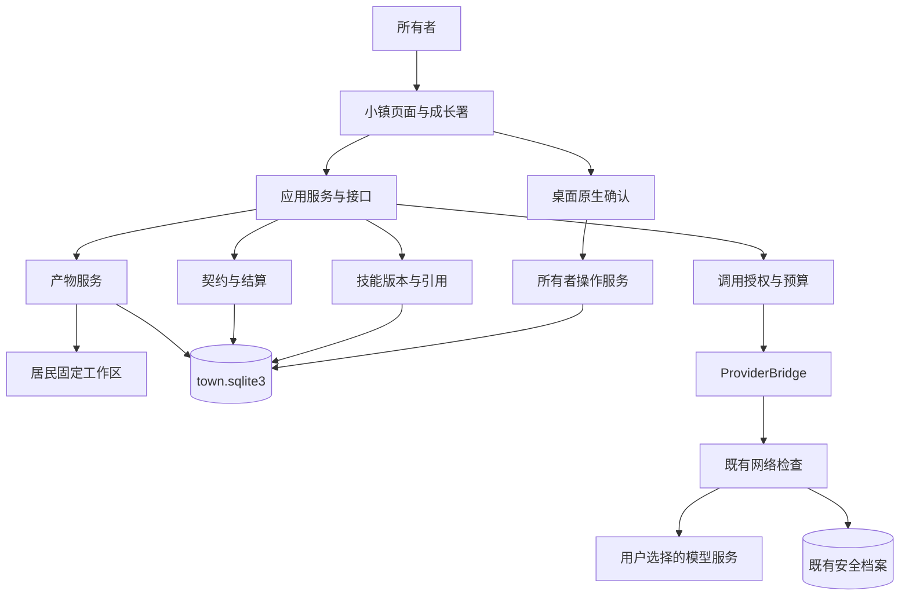
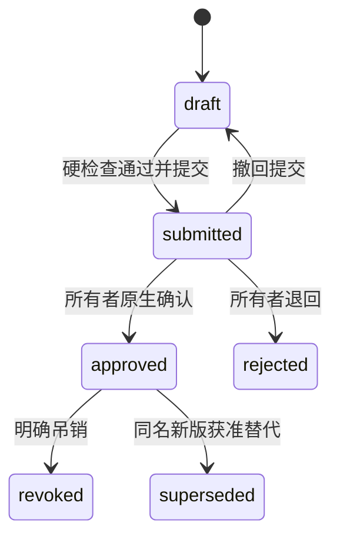

# 星栖小镇 V2.0 需求设计文档与实施变更

> 主题：可追溯产物、职责契约、成长署与受控技能引用。
> 原稿中的可追溯成果、职责契约、技能引用和预算逻辑已进入本地源码实现，并补充成长署自动培养与资料出入口控制。当前功能、参数和使用流程以 [V2.0 需求与实现说明](GROWTH_V2.md) 为准；下文保留设计推导和历史接口草案，不代表逐项原样落地或已经发布。

| 项目 | 内容 |
| --- | --- |
| 文档版本 | V2.0 |
| 修订日期 | 2026-11-14 |
| 目标产品版本 | `2.0.1`，发布说明见 `UPDATE_2.0.1.md`；保留原 `v2.0.0` 构建记录 |
| 已核对代码基线 | 原设计基于 `b80bf8a`；本次实施基于最新拉取的 `2f79e53` |
| 输入 | 所有者提供的 `DESIGN-v1.14.md` 与本地代码评审结果 |
| 文档状态 | 原设计与实施变更对照；实际默认参数见 `GROWTH_V2.md` |
| 本文位置 | `docs/DESIGN-v1.14-v2.md` |
| 实施原则 | 分阶段交付、旧存档兼容、真实证据、最小执行能力 |
| 发布依据 | 仓库 [发布手册](RELEASING.md)；本文不复制发布操作步骤，也不构成发布授权 |

## 实施变更：以本节及新版说明为准

根据后续讨论，本次将成长署明确为 HR：用户统一确定方向、范围和预算，成长署依据岗位与近期任务证据自动生成每日基础任务，居民自行完成文本练习。用户不需要逐一替每名居民编写任务。领航负责真实项目的岗位分工，稽查署负责模型端点与资料流转的后端门禁。

| 原稿假设 | 当前实现 |
| --- | --- |
| 暂定产品 v1.14.0，仅记录产出 | 产品 `2.0.0`，加入受限自动培养与项目文本任务 |
| 每日自动任务留待后续 | 默认关闭；原生确认居民、端点和额度后，可在应用运行时调度 |
| 成长署只统计与验收 | 生成岗位计划、保存练习、比较基线与独立案例结果；主观成果仍人工验收 |
| 小镇八位 / 新版九位，最多三十位 | 最新上游已有十位；增加成长官后初始十一位，容量三十三位 |
| 成长署编号 `resident-growth-officer` | 实际编号 `resident-growth`，房屋名“成长署”，满镇仍可打开工作区 |
| 技能关键词匹配和手动选择 | 当前按有效启用版本的提交时间选择完整依赖闭包，最多两个文本 / 8 KiB |
| 建议表结构、API 与模块名 | 实际为 `v2_*` 表和 `town_store/artifacts/budget/skills/owner_actions/growth.py`；见新版说明 |
| 建议预算 20,000 / 200,000 Token | 实际默认每居民每日 100,000、累计 3,000,000，原生确认后启用 |
| 完整回归作为整版交付前提 | 开发收尾按所有者要求不继续本地回归；发布依赖确切提交的 GitHub Checks 与三平台构建结果 |

下面章节中的“待实现”、原有测试矩阵、接口草案和候选参数保留为设计参考。涉及自动任务范围、居民数、实际端点、默认额度和验证状态时，以 [新版说明](GROWTH_V2.md) 为准。

## 1. 修订结论与产品目标

### 1.1 本版要解决的问题

当前居民可以聊天，工作区已预建，但缺少把某一次真实对话转化为持久成果的产品流程。成长册主要读取外部台账，用户无法在小镇内完成“保存成果—验收—复用”的过程。模型调用已有统一入口，但尚未保留 token 用量，也没有居民级预算账户。

原稿的成果主流程为：

**居民生成文字 → 用户选择保存 → 程序校验来源并落盘 → 按契约统计产出 → 用户验收成果 → 经审核的技能作为后续对话参考。**

“产出达成”只表示满足已声明的数量、类别和证据条件。“已验收”来自明确的人工裁决。“已验证改进”继续采用原有包含基线、候选结果和回归证据的标准。三者分别展示，不互相折算。

### 1.2 本版目标

| 编号 | 需求 | 完成后的用户可见结果 |
| --- | --- | --- |
| FR-01 | 将完成的居民回复保存为产物 | 能从聊天进入成果，反查居民、原消息和生成任务 |
| FR-02 | 安全写入、不可变版本与来源链 | 能区分原回复、人工整理、交付副本和演示数据 |
| FR-03 | 显式跨居民交付 | 收件人得到材料副本，保留作者与来源，不重复算原创产出 |
| FR-04 | 职责契约与每日统计 | 明确今天安排了什么、完成多少、哪些记录未计入 |
| FR-05 | 成果验收 | 所有者确认后才显示“已验收”；程序保留裁决证据 |
| FR-06 | 技能版本、检查、人工核准与受控引用 | 仅当前有效的已核准版本参与指定居民的对话 |
| FR-07 | 调用计量与居民共享预算 | 展示实际、估算、未知用量，并在支持的连接上做发送前准入 |
| FR-08 | 请求阻断、居民暂停、授权吊销 | 区分一次请求的问题与持续停用，说明在途请求的处理结果 |
| FR-09 | 成长署工作区与可选入住 | 集中查看产出、验收、技能与通知；满镇时仍可使用工作区 |
| FR-10 | 升级、恢复与可保留数据的回滚 | 更新失败不清空成果，关闭功能不删除证据 |

### 1.3 范围边界

本版由应用内置代码保存文本文件，不执行模型生成的脚本、命令或第三方 Skill。技能在本版的含义是“经核准、带版本的文字参考”，不会授予文件读取、Shell、联网、派单或自动调度权限。

实施范围已扩充为用户授权后的每日岗位文本训练和项目任务。每日契约仍只定义统计要求，付费模型请求由成长署调度并经过统一预算门禁。通用工具执行器、向量数据库、远程多用户、自动审批和自动修改配额不在本次实现范围内。

实施时新增城内有限训练的独立案例比较，保存基线、候选回答、规则和参考版本。它只证明本次任务的参考收益，不等同于外部台账中的通用能力改进，也不表示训练了模型权重。现有外部改进记录继续独立、只读展示。

### 1.4 相对原稿的主要决策

| 原稿设计 | 本版决策 |
| --- | --- |
| 有产物接口，但未定义产出入口 | 先交付“保存当前回复”和“人工整理”两个入口 |
| 数量与最大字节数判定达标 | 逐条校验后去重计数；验收与改进另列 |
| 用房屋样式持续决定契约 | 契约独立；房屋样式只用于一次性推荐，默认不启用 |
| 前端传入来源等事实字段 | 来源、作者、哈希和字节数由服务端推导 |
| 审核令牌注入网页全局变量 | 原生窗口确认，宿主通过私有凭据提交裁决；网页不持有审批秘密 |
| 按虚拟 key 分配预算 | 使用内部授权编号；所有授权共享居民预算，不引入虚拟密钥 |
| 发送前只读检查余额 | 在同一事务中预占，返回后按调用编号幂等结算 |
| 可疑内容一律吊销 | 硬规则阻断、启发式待复核、速率冷却与持续暂停分别处理 |
| 回滚删表、最近 200 条之外删除 | 关闭入口保留数据；归档不切断证据链 |
| 单阶段都更新产品版本 | 开发阶段不自动升版本；整版发布时按发布手册同步版本文件 |

## 2. 已核实基线与待确认依赖

### 2.1 已有能力

| 能力 | 当前入口 | 实施影响 |
| --- | --- | --- |
| 居民、消息、聊天任务与偏好 | `server.py:TownApp` | 复用稳定居民编号、消息编号和任务编号 |
| 每居民最多一个活动聊天，全局最多两个 | `TownApp.chat()` | v1.14 保留限制；预算模块自身仍需支持并发一致性 |
| 模型统一入口 | `ProviderBridge.generate_for_agent()` | 可携带居民与调用上下文；当前只返回字符串 |
| API 请求检查 | `SecurityOffice.network_check()` | 复用既有阻断；将规则原因结构化 |
| 密钥管理 | `credential_store.py` | 继续使用系统凭据存储，不进入新表或前端 |
| 独立的安全档案 | `town_security.py` | 保持原有数据库与记录，不搬迁或重建 |
| 工作区预建 | `SecurityOffice.ensure_workspace()` | 固定 `skills/books/materials/results`；已有人工文件不自动登记或覆盖 |
| 成长证据规则 | `TownApp.verified_improvement()` | 保留其基线、候选结果、复核人与回归证据要求 |
| 新角色补入空地块 | `TownApp._migrate_security_residents()` | 成长署借鉴已存在的迁移方式 |
| 桌面进程与内嵌页面 | `desktop_runner.py`、`desktop/App.swift`、`desktop/WindowsHost.cs` | 新增原生审批通道，两平台都需要实现 |

原设计基线曾为八位居民、容量三十位。实施基线 `2f79e53` 已包含十位初始居民和三十三位容量，V2 增加成长官后为十一位。原先缺失的输出上限与响应 `usage` 已接入统一预占、发送门禁和结算流程，详情见新版说明。

### 2.2 不纳入基线的内容

原设计核对时尚未包含研发小组迁移。本次实施基线已包含 `_migrate_team_residents`、产品经理杨辉 `resident-yanghui` 和测试工程师阿力哥 `resident-alige`；沿用原有搬迁与存档保留逻辑。其他未核实的草案名称不作为当前接口依据。

### 2.3 本地验证记录

基线检查使用 Windows、Python 3.11 与 Node 25：Python 共 203 项，194 项通过、7 项跳过、2 项在创建符号链接时因 Windows 权限不足报错；六组 Node 测试共 73 项通过。这是本地证据，不等于完整跨平台 CI 或安装包验收。实施后以实际测试发现结果为准，不把固定测试数量作为通过标准。

## 3. 用户流程与页面要求

### 3.1 保存居民回复

1. 对已经完成的助手回复显示“保存为成果”。等待中、失败、取消或仅包含用户输入的消息不能以居民原回复身份保存。
2. 弹窗允许选择类别、产物类型和标题，显示将保存的正文、来源居民和来源时间。
3. 服务端通过 `message_id` 查出消息与对应的完成任务，校验请求中的居民与原作者一致，不接收客户端自报的作者、来源类型或哈希。
4. 预览执行统一文本标准化与敏感内容处理。用户确认的是最终保存文本；保存时校验预览摘要，发生变化要求重新预览。
5. 写入成功后显示“已保存”，提供“查看文件内容”“查看原对话”“交付给居民”“提交验收”。只写到暂存区时不显示完成。
6. 双击、网络重试和刷新重发返回同一产物，不创建多份。

如果正文超过 32 KiB，不自动截断。提示用户改用“整理为笔记”并明确其人工整理来源。

### 3.2 人工创建与整理

用户可以创建笔记，或者从回复复制内容后编辑保存。编辑后的产物标记为“人工整理”，`actor=owner`，可关联原消息；不会继续声称它是居民未经修改的原回复。

正文不包含实际敏感值时直接预览；发现疑似凭据时提供定位与遮盖后的预览。确认遮盖后的文本才允许入库，界面不在提示中重复展示原始敏感值。原聊天记录不因保存操作被修改。

演示标记默认由运行数据环境及来源确定。用户可将新记录标记为演示，来源已是演示时不能通过请求清除该标记。本版不提供把既有演示记录改成正式记录的入口。

### 3.3 查看、验收与修订

产物详情展示内容、所属居民、作者类型、来源、保存时间、大小、文件状态和验收结果。正文是纯文本或受限 Markdown，不执行 HTML、脚本或资源引用中的网络请求。

所有者可提交“验收通过”“退回修改”“撤销验收”。验收绑定具体内容哈希和来源摘要，需要原生确认；退回和撤销必须填写理由。成长署只记录并展示裁决。

已保存产物正文不可原地修改。修改产生新产物版本，关联 `previous_id`；旧验收不自动继承。文件在应用外变化时显示“内容已变化”，原验收作为历史事实保留，但不再声称覆盖当前文件。

### 3.4 交付材料

所有者在产物详情选择接收居民并确认交付。程序复制当前已验证版本到接收方 `materials/`，记录原作者、直接来源、根来源与交付时间。交付不启动接收方聊天，不产生新的模型费用。

相同根来源向同一居民重复交付返回既有副本。原作者不能通过材料往返再获得一份原创产出；演示标记沿来源链继承。接收方可以基于材料产生自己的新回复并另行保存，但“收到材料”本身不计入其原创 KPI。

本版不自动把收到的材料加入模型上下文。只有所有者明确选择后续对话参考内容，或将内容制作成经核准的技能，才会进入模型请求。

### 3.5 契约与每日记录

成长册展示三组独立信息：“本地产出”“本地验收”“已有验证改进”。点击数字可查看对应证据和不计入原因。默认没有每日硬性要求，不以居民职业名称自动开始考核。

所有者在居民页选择推荐契约、调整要求并启用。页面说明“此安排只统计成果，不会自动让居民工作或产生模型费用”。契约修改默认北京时间次日生效；v1.14 不提供追溯修改历史契约的入口。

当日记录显示暂结结果，关闭应用不视为任务失败。无契约显示“未安排”；已有安排且零产出显示“暂无符合要求的产出”；证据不可读显示“统计暂不可用”，不能伪装成零产出。

### 3.6 技能制作与使用

用户将某个 `skills/` 类别的产物提交为技能版本，填写名称、说明、关键词和依赖。页面展示检查结果、内容变化、依赖与预计上下文占用。

机检硬错误必须修正；启发式风险可以进入待审队列，由所有者查看上下文并说明处理理由。人工批准不允许越过硬性路径、所有权、执行与网络边界。

发送对话前，输入框附近显示本轮将引用的技能名称和版本。用户可以移除自动匹配项或手动选择有效技能；这不会提高权限。回复详情保存“本次引用了哪些版本”，不承诺模型一定遵循参考内容。

### 3.7 成长署

新增“成长署”工作区，包含今日概况、成果、验收记录、职责契约、技能队列、历史和通知。所有者的审批与配置操作在该视图发起，但由应用权限服务执行。

新增成长署居民实际使用稳定编号 `resident-growth`。有空地块时入住；满镇时工作区照常可用。新安装默认十一位居民，最大容量三十三位；旧存档按迁移标记补入该居民，不重置其他居民资料。

成长署角色聊天只能解释记录，不能通过回复批准技能、通过验收、修改契约或调额度。原生确认对话框和最终应用操作不由模型参与。

## 4. 系统结构与职责



| 组件 | 负责 | 边界 |
| --- | --- | --- |
| 产物服务 | 文本标准化、安全落盘、来源、交付、恢复 | 不调用模型判质量，不执行产物 |
| 契约与结算 | 读取契约快照与证据，计算并解释统计 | 不批准成果，不生成改进结论 |
| 技能服务 | 不可变版本、机检、状态、上下文选择 | 不开放文件工具或动态代码加载 |
| 预算服务 | 居民账户、预占、结算、暂停与授权 | 不保存 provider key，不等同服务商账单 |
| 巡检警官 / 稽查署 | 保留既有检查；返回结构化风险与阻断决定 | 不批准内容质量，不自动提高配额 |
| 成长署 | 统计展示、备案、裁决和通知查询 | 不以角色身份作出所有者裁决 |
| 所有者操作服务 | 校验原生确认、并发版本、一次性操作与证据 | 网页或居民不能自行制造确认结果 |

新业务数据位于同一个 `town.sqlite3`，便于产物状态、审批、预算和业务证据在本库内事务提交。既有 `scout-workshop/` 与 `security-office/` 数据库保留；跨库不声称原子提交。网络检查失败或无法落档时继续按现有规则拒绝发送。

## 5. 数据模型与全局约束

### 5.1 命名、时间与不可变内容

- 使用随机 UUID 生成带前缀的对象 ID，不依赖显示名和客户端路径。所有关系使用稳定 ID。
- 时刻使用 UTC ISO 8601；业务日期使用既有 `TOWN_TZ`。存储 `created_at` 与独立 `business_day`，禁止截取 UTC 字符串推导北京时间日期。
- 正文以 UTF-8、无 BOM、LF 保存；不擅自修剪代码缩进。正文摘要针对最终保存字节计算 SHA-256。
- 所有新连接启用外键，token 绝对量与账户余额使用非负整数；账务调整差额可以为负，但提交后的余额不能为负。声明字段严格校验，不接受布尔值冒充整数。
- 已发布产物正文、技能内容、契约版本和裁决事件不可修改。状态投影可更新，但必须与对应事件在同一事务中提交。
- 摘要证明内容一致性，不证明作者身份或内容质量；作者来源还依赖消息、任务、所有者操作及来源链。

### 5.2 逻辑表定义

下表是实施必须覆盖的逻辑结构。可调整非公开列名，但不能省去版本、幂等、来源和恢复约束；最终 DDL 随迁移一起评审。

| 表 | 核心字段 | 约束与用途 |
| --- | --- | --- |
| `schema_migrations` | version, checksum, applied_at | 迁移编号唯一；发现同号不同摘要拒绝继续迁移 |
| `mutation_receipts` | operation, request_id, payload_hash, target_id, state, created_at | `UNIQUE(operation, request_id)`；同号不同内容返回冲突；不存完整请求正文 |
| `contributions` | id, owner_agent_id, category, kind, title, body_sha256, byte_count, relative_path, source_type, source_message_id, source_job_id, actor, previous_id, source_contribution_id, root_contribution_id, demo, normalization_version, redaction_applied, state, acceptance_state, revision, created_at, published_at, business_day | 路径由服务端产生；来源字段按来源类型校验；正文不可变；business_day 由 published_at 推导 |
| `contract_versions` | id, agent_id, version, active, scope, requirements_json, weekdays_json, effective_from_day, created_at, owner_action_id | `UNIQUE(agent_id, version)`；按生效日读取历史版本，不覆盖 |
| `kpi_days` | agent_id, day, revision, contract_version_id, outcome, phase, required_json, actual_json, evidence_json, rule_version, supersedes_revision, computed_at | `UNIQUE(agent_id, day, revision)`；每次修正追加快照，查询默认最新 |
| `skill_versions` | id, skill_id, agent_id, version, normalized_name, contribution_id, manifest_json, manifest_hash, status, revision, expires_at, superseded_by, created_at | `UNIQUE(agent_id, normalized_name, version)`；version 为内容版本，revision 为状态修订；正文引用不可变产物 |
| `skill_checks` | id, skill_version_id, manifest_hash, rule_version, outcome, findings_json, coverage_json, created_at | 只追加；批准和使用须核对当前规则及当前内容 |
| `grants` | id, agent_id, purpose, skill_version_id, status, expires_at, created_at, revoked_at, reason_code, revision | 内部授权编号，不是持有即可调用的秘密；所有授权共享居民账户 |
| `budget_policies` | id, agent_id, version, mode, request_total_cap, output_cap, daily_cap, lifetime_cap, effective_at, owner_action_id | 版本化；各限额含义固定；配置变化不清零用量 |
| `budget_accounts` | agent_id, consumed_total, reserved_total, access_state, access_revision | 每居民一行；更新总用量和持续暂停状态 |
| `budget_days` | agent_id, day, consumed, reserved | `PRIMARY KEY(agent_id, day)`；跨日创建新行，不重写旧行 |
| `model_calls` | id, job_id, attempt, agent_id, grant_ids_json, skill_snapshot_json, policy_id, provider_config_revision, provider_mode, model, purpose, budget_day, request_fingerprint, reserved_tokens, prompt_tokens, completion_tokens, usage_quality, estimator_version, state, outcome, dispatch_revision, created_at, completed_at | `UNIQUE(job_id, attempt)`；不存请求正文、密钥或完整 URL；来源编号支持产物追溯 |
| `usage_events` | seq, call_id, event_type, delta_consumed, delta_reserved, budget_day, quality, reason_code, previous_hash, digest, created_at | 追加账务事实；终态结算幂等；调整事件引用原结算 |
| `owner_action_intents` | id, action, target_type, target_id, expected_revision, payload_json, payload_hash, expires_at, consumed_at, result_ref | 只存有限操作参数；有效期短；最终裁决必须来自原生宿主 |
| `evidence_events` | seq, event_type, actor, target_type, target_id, target_hash, payload_json, previous_hash, digest, created_at | 审批、验收、交付、归档、契约、策略与完整性变化的追加事实 |
| `growth_notices` | id, agent_id, reason_code, severity, source_event_id, created_at, read_at | 通知独立于 KPI；已读状态不改变原事件 |

### 5.3 状态与数据库约束

以下枚举使用 `CHECK` 或同等强度的数据库约束，引用使用外键并采用保留证据的删除策略：

| 对象 | 状态 |
| --- | --- |
| 产物文件 | `pending / available / archived / changed / missing / failed` |
| 产物验收投影 | `unreviewed / accepted / returned / withdrawn` |
| 技能版本 | `draft / submitted / approved / rejected / revoked / superseded` |
| 技能当前可用性 | 由状态、过期、检查规则、来源完整性、依赖和授权联合计算，不只看 status |
| 授权 | `active / revoked`；到期是派生状态；吊销后不复活，重新授权使用新编号 |
| 居民模型访问 | `active / suspended`；恢复不返还预算，不复活旧授权 |
| 调用记账状态 | `reserved / sending / settled / released / unknown / blocked` |
| 调用业务结果 | `completed / cancelled / timeout / provider_error / blocked / interrupted` |

`evidence_events`、`usage_events`、`skill_checks`、历史契约与 KPI 快照禁止业务接口更新或删除。哈希链表增加禁止 UPDATE/DELETE 的触发器；追加事件用事务串行读取链尾并插入。链校验异常时停止新的有效裁决和受控模型发送，保留诊断查询。

当前状态列是事件的投影，恢复时可与事件核对。哈希链用于发现应用内违规修改及普通数据损坏，不声称抵御本机管理员重写程序、数据库或系统时钟。

`revision` 随影响审批的状态变化递增，与不可变内容的 version 分开；审批使用条件更新校验它。未完成调用的 outcome 允许为空，终态必须写入具体结果。事件规范化 JSON 固定键序、分隔符和 UTF-8 编码，再连同前序摘要计算哈希，不能依赖字典偶然顺序。

### 5.4 来源、幂等与去重

`source_type` 固定为 `chat_reply / manual / manual_derived / delivery`；本版没有 `scheduled` 产物。`chat_reply` 必须来自助手完成消息；`manual_derived` 必须保留参考消息或产物编号；`delivery` 必须存在可读的源产物并保留根来源。

根来源指一个不可变的非交付产物版本。新修订以自己的 ID 为根，用 `previous_id` 连接旧版本；交付副本始终继承源版本的根 ID。因此重复交付同一版本不会新增副本，而真正的新修订可以作为新版本交付。来源链不能形成循环。

客户端只能提出“保存哪条消息”“保存哪些手工文字”“交付哪个产物”，不能直接指定 `source_type`、哈希、真实作者、根来源或清除演示标记。

三个不同概念分别处理：

1. **请求幂等**：同一操作编号重试返回同一结果，同号不同正文返回 `409 idempotency_conflict`。
2. **保存去重**：同居民、同来源身份、同类别、同类型、同标准化内容重复保存返回已有记录；标题差异不自动产生新成果。不同真实来源可以保留各自的记录，但不因此多计分；不能把先前人工整理的记录冒充为后来某次模型原回复。交付另以“根版本 ID + 接收居民”唯一，不与接收人的人工记录合并而丢失来源。
3. **计分去重**：同居民的同类同类型内容在历史上只按第一次符合条件的来源记录计入；交付副本不参与原创计分。验收指标按首次有效验收计入，撤销再验收同一内容不新增份数。

这些规则防止完全重复与回传刷数，不承诺识别语义近似或判断内容价值。

上述唯一性必须通过数据库唯一索引或同事务的唯一键登记实现，不能只在写入前查询是否存在。指向失败发布的回执不得永久占用正常重试机会，但重试不得覆盖已确认可用的对象。

## 6. 产物写入、完整性与交付

### 6.1 路径规则

目标只能是应用数据目录下的 `workspaces/<resident_id>/<category>/<generated_id>.md`。文件名由程序生成；标题、技能名、模型文字不能参与路径拼接。API 不接受绝对路径、任意文件名或子目录。

固定类别为 `skills/books/materials/results`。`kind` 为独立的受控业务类型，首版提供 `note/spec/test_case/report/summary/skill_reference`，扩展需更新允许列表。`category=books, kind=note` 合法，`notes` 不是目录类别。

实际读写时校验根目录、居民目录、类别目录和目标父链，拒绝符号链接、Windows junction/reparse point、UNC 路径、盘符、备用数据流、控制字符及越界路径。不能只依赖 `posixpath.normpath()`。恢复、归档、交付与读取也必须走同一校验入口。

对实际文件句柄进行可用的身份与类型复核，写入前后检查父目录未被替换。环境不支持安全验证或发现异常时，拒绝该次写入并给出可恢复错误。此约束不提供对本机管理员的对抗保证。

### 6.2 标准化与发布协议

单份最终正文上限 32 KiB，技能正文上限 16 KiB。HTTP 总请求继续受请求体总大小限制；JSON 转义导致总请求超过限制时返回明确的 `413`，不静默截断。

数据库事务不能覆盖文件系统操作，采用以下可恢复协议：

1. 验证消息、任务、目标居民、正文与预览摘要；生成不可变产物编号。
2. 在受控类别目录的应用暂存区域写入最终字节，刷新文件并计算哈希；暂存文件不被当作有效成果或技能。
3. 事务内登记 `pending` 产物、目标路径、期望哈希与幂等回执。
4. 将暂存文件发布到同卷唯一目标；禁止覆盖既有不同内容文件。使用安全的同卷原子重命名，并校验已有目标的身份和哈希。
5. 再次核验目标；事务内改为 `available`，追加保存事件并完成回执。
6. 在第 5 步完成前，KPI、技能引用与交付都不可使用该记录。

正文中疑似凭据的处理发生在预览与哈希之前。哈希、字节数、人工确认内容和实际文件必须一致。不要在批准技能之后再悄悄脱敏改变其正文。

### 6.3 启动恢复

| 恢复状态 | 处理 |
| --- | --- |
| 有暂存文件，无数据库记录 | 标记为应用孤立暂存；宽限期后可清理，不计分 |
| pending + 暂存完整 | 校验后继续发布并完成原回执 |
| pending + 目标完整 | 校验目标哈希后完成入库，不重复写文件 |
| pending + 两处缺失或哈希不符 | 记录失败/异常；不虚构完成，允许用户重试 |
| available/archived + 内容变化或消失 | 更新完整性投影并追加事件；停止当前引用与当前有效验收展示 |
| 目标路径已被外部文件占用 | 返回冲突，不覆盖外部文件 |

首次恢复必须在启动统计与技能引用之前完成，不能边恢复边把 pending 计入成果。清理仅限已确认归属本应用的暂存物。

### 6.4 证据时效

验收、交付、技能提交和引用前重新检查文件。当前统计查询执行有界的文件状态校验；后台增量复核不能替代敏感操作前的检查。

历史“当时通过验收”的事件不因后来删文件而消失，但当前证据不可用时要显示缺失或变化。需要修正历史统计时追加新修订和原因，不覆盖旧快照。

归档只是展示状态，首版不移动或删除正文。已归档且内容完整的记录仍可作为历史统计与验收证据；不能因为用户整理列表就扣掉原有成果。`archived` 与当前文件完整性联合判断，不能把归档当成缺失。

## 7. 职责契约、结算与验收

### 7.1 契约结构

契约与角色、房屋、美术外观独立。下面是推荐模板，不会自动启用：

```json
{
  "scope": "development",
  "active": false,
  "weekdays": [1, 2, 3, 4, 5],
  "requirements": [
    {
      "id": "daily_spec",
      "category": "results",
      "kinds": ["spec", "report"],
      "metric": "produced",
      "quota": 1,
      "min_bytes": 80,
      "allowed_sources": ["chat_reply", "manual_derived"]
    }
  ]
}
```

`metric` 支持 `produced` 和 `accepted`。同一契约内 requirement ID 唯一；同一 metric、类别与 kind 的匹配范围不得重叠，避免一条记录满足多个同义要求。`quota >= 1`，`min_bytes` 在正文上限以内。`active=true` 时 requirements 不可为空；不考核必须显式关闭。

weekdays 使用 ISO 编号，星期一为 1、星期日为 7。同一生效日可以追加更高版本替代尚未生效的建议，但必须校验用户看到的最新版本；查询按不晚于业务日的生效日、版本号倒序选择唯一有效版本，旧记录继续保留。

默认建议为：开发/架构岗位使用 `results`，知识整理使用 `books`；巡检、稽查、成长署不默认纳入，其他角色不默认纳入。新居民只创建未启用的推荐模板。启用、停用与修改均创建契约新版本，需要所有者确认，不以改房屋或角色简介自动修改。

### 7.2 日期归属

- `produced` 使用服务器确认产物可用时的北京时间日期。
- `accepted` 使用首次有效人工验收事件的北京时间日期；晚验收不会回填为原保存日的新成果。
- 新契约默认次日生效；一日始终采用该日生效的固定契约版本。
- 每周未安排日期显示“未安排”。应用关机不补造产物、不补发模型请求。
- 操作系统时钟显著回退时暂停自动终结日结算并提示核对，不自动重写历史归属日期。

### 7.3 结算规则

每一条候选记录必须同时满足：类别和类型匹配、来源允许、非演示、文件可用、字节数达标、去重规则通过；`accepted` 还需当前有效且绑定相同内容的人工验收。

```python
def evaluate_requirement(requirement, candidates):
    eligible = []
    excluded = []
    for item in candidates:
        reason = eligibility_reason(item, requirement)
        if reason is not None:
            excluded.append({"id": item.id, "reason": reason})
        else:
            eligible.append(item)
    unique = deduplicate_by_evidence(eligible)
    return {
        "count": len(unique),
        "quota": requirement.quota,
        "met": len(unique) >= requirement.quota,
        "evidence_ids": [item.id for item in unique],
        "excluded": excluded,
    }
```

这是规则说明伪代码。实现把纯判定函数与数据库持久化分开，不把会写数据库的函数称为纯函数。所有字段先完成校验，空要求不会进入 `all()` 判定。

### 7.4 结果与触发

| outcome | 页面文案 | 含义 |
| --- | --- | --- |
| `not_scheduled` | 未安排 | 没有当日有效启用契约 |
| `no_output` | 暂无符合要求的产出 | 已安排，但合格数为零 |
| `partial` | 已完成部分要求 | 有合格产出，尚未达到全部要求 |
| `met` | 已达到产出要求 | 所有要求的合格数量均满足 |
| `unavailable` | 统计暂不可用 | 契约、证据或数据库异常；不得显示为零或通过 |

`phase=open/final` 独立表示暂结和日结。产物完成、验收、撤销或完整性变化时触发增量重算；跨日时终结上一日；重启后按实际证据补结历史，不补跑工作。读取接口本身不创建新的模型任务。

每份快照保留契约版本、规则版本、证据 ID/哈希、排除原因与计算时间。已结日发现新情况时追加修订并保留旧快照。外部台账与本地成果使用不同来源标识，不直接相加成“总已验收工作”。

## 8. 技能版本、审核与上下文

### 8.1 技能清单

```json
{
  "format": 1,
  "name": "需求检查参考",
  "description": "帮助整理功能范围和验收条件",
  "keywords": ["需求", "验收", "边界"],
  "scope": "self",
  "network": false,
  "reads": [],
  "writes": [],
  "uses": []
}
```

本版 `reads/writes` 必须为空；引用的文字由应用按技能版本取出，不让技能声明任意文件访问。未知字段拒绝，不接受来自 front-matter 与 JSON 的两套相互覆盖配置。用户输入可以被解析为预览清单，但批准的是唯一标准化清单。

`manifest_hash` 覆盖标准化清单、正文哈希、所属居民、版本、过期时间及依赖版本哈希。技能正文通过 `contribution_id` 引用类别为 `skills` 的不可变产物；正文存储和清单不会各自维护不同副本。

### 8.2 状态流转



修改任何版本正文或清单，创建新版本草稿；原记录不变。拒绝版本不直接改写后再批准。已批准版本过期、检查规则过时、来源变化或依赖失效时，派生为“当前不可用”，保留历史批准事实。

默认每居民最多五个当前可用技能。同名替代审批可在一个事务中批准新版本并停用旧版本，不能先腾空授权再失败。源码文件放进 `skills/` 不等于技能已批准。

### 8.3 机检分类

| 类型 | 示例 | 处理 |
| --- | --- | --- |
| 硬错误 | 非 self、非空读写、请求联网、错误字段、超长、未知居民、来源已变 | 留在 draft；所有者也不能直接批准越过 |
| 依赖错误 | 跨居民引用、未批准/过期依赖、循环、深度或总量超限 | 留在 draft；明确指出依赖版本 |
| 启发式风险 | 引用“忽略前面的规则”等可能的指令诱导文本 | 保留上下文进入待审；标记人工复核，不宣称恶意或自动安全 |
| 通过 | 未发现上述问题且检查完整 | 允许提交；仍需人工核准 |

规则输出结构化 `rule_id/severity/reason/coverage`，不凭 `problems=[]` 宣称内容安全。未覆盖或读取失败不能获得完整通过结果。

### 8.4 依赖与引用选择

`uses` 指向本居民的确切 `skill_version_id + manifest_hash`，不允许“始终使用最新版”。检查禁止循环，最大依赖深度二层。被依赖技能撤销后，依赖它的技能立即不可引用；重新批准一个新版依赖不会悄悄替换历史引用。

自动匹配只读取本轮用户正文与技能关键词，使用确定性的命中规则；同分按稳定 ID 排序。手动选择优先。每次最多两份技能正文，依赖闭包也算在这两份以内；总技能正文不超过 8 KiB，并同时受最终请求的 token 预算约束。

自动选择装不下完整依赖闭包时跳过该候选并可解释原因；手动选择超限返回明确错误，不截断依赖或正文。发送前再次校验状态、所有权、哈希、规则版本、依赖和授权，记录本次实际版本快照。

技能作为带来源的参考资料置于受限数据区域，系统规则保持“没有工具与外部执行能力”。提示词边界不能代替程序权限检查；正文不得被拼接为新的系统角色或工具定义。

## 9. 所有者确认与桌面通道

### 9.1 保护的操作

技能批准/拒绝/吊销、成果验收/撤销、契约启停/修改、预算模式与限额修改、居民暂停/恢复、授权重新签发都需要所有者确认。普通保存、查看、标记通知已读不触发额外原生确认。

第一版不做批量通过。后续若添加，必须逐项绑定版本与哈希，原生窗口展示全部项目，禁止以“机检通过”替代确认。

### 9.2 协议

1. 网页调用 `POST /api/owner-actions` 创建操作意图。服务端生成规范化操作快照，包含对象版本、内容哈希、具体动作和参数，返回 `intent_id` 与可显示摘要。
2. 网页通过有限的桌面消息桥申请打开确认窗口，只传 `intent_id`。原生宿主只接受当前小镇顶层页面、当前实例的消息，限制一次一个确认窗口。
3. 原生宿主用自己的私有会话凭据向后端读取真实操作快照，不把网页提交的标题、正文或金额当作确认依据。
4. 原生窗口展示居民、操作、完整可查看正文/差异、依赖、限额变化及风险。用户取消则结束，不提交裁决。
5. 用户确认后，宿主向内部接口发送 intent ID、快照摘要与确认结果。后端在同一事务中重新验证状态、版本、规则、有效期和权限，执行操作、追加证据并消费意图。
6. 网页只查询操作结果；它不获得宿主秘密，也不获得可复用审批票据。

意图有效期建议五分钟。重复确认同一已消费意图返回原结果；对象变化、过期或摘要不符返回冲突，必须重新展示。并发审批不会双重生效。

### 9.3 私有凭据与接口

宿主启动后端时通过继承的匿名管道传入随机会话凭据。凭据仅驻留双方内存，不进入命令行参数、环境变量、ready 文件、数据库、页面全局变量、日志或崩溃提示。

内部接口可复用本机服务端口，但单独校验宿主凭据与实例身份，不接受网页 Origin、CORS 或普通 `X-Town-Client` 作为授权。仅知道内部路由或 intent ID 不足以确认操作。所有比较使用常量时间比较；重启后旧会话凭据作废。

Windows 与 macOS 分别实现启动管道、原生确认和导航来源验证。正常桌面包不开放开发绕过参数；自动化测试使用明确注入的假宿主与临时数据，不把审批令牌打印到日志来调试。纯后端开发模式可查看和提交草稿，未连接宿主时审批不可用。

这条保证针对未持有宿主秘密的网页脚本与居民内容，不把同用户调试器、本机管理员或已被修改的宿主视为可隔离的攻击者。

## 10. 模型计量、预算与授权

### 10.1 按能力启用

| 模式/连接 | 普通聊天 | 保存回复 | 技能引用 | 用量 | enforce 预算 |
| --- | --- | --- | --- | --- | --- |
| 兼容 API，已验证输出限制与输入计量能力 | 保留 | 支持 | 审批后支持 | 优先实际 usage | 支持本地准入与结算 |
| 兼容 API，计量或输出上限能力不确定 | 保留 | 支持 | 仅 observe 且界面明确不受可靠额度约束 | 估算/未知并明确标记 | 禁止启用，返回能力不足 |
| 本机 Codex | 保留 | 支持 | 本版禁用，作为明确产品取舍 | 记录外部调用次数及未计量状态 | 不支持 |

小镇可以控制是否发起 Codex 调用，但不能据此声称观察了其实际网络或掌握精确费用。启用 enforce 的居民切换到不支持的连接时，拒绝新模型调用并提示所有者调整；不能静默降级绕过预算。

默认 `observe`，保留原有聊天体验；新建或升级不会突然启用每日上限。Codex 技能限制是本版范围选择，不是“文字参考本身必然无法受控”的结论。

### 10.2 额度定义

| 参数 | 定义 |
| --- | --- |
| `request_total_cap` | 本次完整输入与最大输出的预算总和上限 |
| `output_cap` | 发送给适配器的最大输出 token 数；不同 provider 参数由适配器处理 |
| `daily_cap` | 居民该预算日已记账加未完成预占的上限 |
| `lifetime_cap` | 居民累计已记账加未完成预占的上限，换授权/模型不清零 |
| `mode` | observe 仅记账；enforce 执行受支持的准入 |

普通聊天和技能引用共享居民账户，不按技能各发一份预算。一次调用引用两个技能仍只生成一条模型调用与一笔完整用量。其他居民的数据与配额相互独立。

新建居民及升级迁移时，程序幂等创建与既有普通聊天能力等价的默认 chat 授权，记录 actor=system，不要求用户重新批准旧功能。技能批准时，所确认的操作明确包含该版本的引用授权，并在同一事务创建；单独恢复已吊销授权才走 grant.issue。新增授权永远不新增账户余额。

输入计量覆盖最终系统提示、角色信息、历史、参考技能和协议封装。enforce 要求适配器提供经验证的计量或输入上界方法，以及可执行的输出上限；不能对任意 OpenAI 兼容地址假设同一 tokenizer 或参数。

observe 可以用记录版本的本地估算器估计输入与输出，但估算值不标为实际值。`len(prompt)//4` 不能作为中文请求的通用上界。token 预算不等于人民币/美元账单，缓存、推理 token 与服务商计费需由适配器明确映射；无法映射时降低计量质量标记。

S3 验收至少需要一个明确的 provider/model 能力档案，包含输入计量依据、输出限制参数、响应 usage 映射和固定测试样本。不能把所有连接都标为未知就宣称 enforce 已完成。若适配器需要新增 tokenizer 等依赖，必须同步评审许可证、离线运行和三平台打包；用户填写模型名不等于该模型自动获得可靠能力认证。

未计量的外部调用不写成零 token。它们保留次数与覆盖范围；累计上限约束小镇已记账的累计量，不声称包含历史上无法计量的 Codex 用量。由 observe 切换 enforce 时显示计量覆盖起点和已有未知记录，不能把过往盲区隐藏。

### 10.3 桥接层返回值

新增结构化结果接口，由真实聊天链路使用。旧字符串接口可作为过渡包装供既有测试与调用者使用，但不能成为绕过统一准入的第二条路径。

```text
ModelResult:
  text
  call_id
  provider_mode
  model
  prompt_tokens: integer | null
  completion_tokens: integer | null
  usage_quality: exact | estimated | unknown | unmetered
  outcome
```

输入输出 token 由适配器规范化、类型和范围校验。解析了 usage 后，即使正文无效、用户取消或安全结果落档失败，也必须保留已发生的记账事实，不把失败回复等同于免费请求。

### 10.4 原子预占

先生成最终请求上下文并完成本地校验，再进行如下流程：

1. 计算 `reserve = input_bound + output_cap`，确定当前 `budget_day`、provider 配置版本与策略版本。
2. `BEGIN IMMEDIATE`：校验居民访问状态、授权有效期、技能版本及策略版本，读取日账户和总账户。
3. enforce 模式下检查 `consumed + reserved + reserve <= cap`；失败只写阻断调用事实，不增加预占。
4. 插入唯一 `model_calls`，增加日/总账户 reserved，追加 reserve 事件，一起提交。
5. 执行既有发送前网络核查；核查拒绝或落档失败时，按“确认未发送”释放预占。
6. 经过发送门禁后才交给 provider；请求输出限制必须与 reserve 使用的值一致。

网络等待不持有 SQLite 写事务。并发控制采用数据库事务与条件更新，不能只靠 Python 层先读后写。所有读取预算的页面都显示“已使用”和“处理中预占”。

observe 模式不依据 token 限额拒绝请求：有估算量时登记带质量标记的预占，无可靠估算或使用 Codex 时登记未计量调用，不伪造预占数量。访问暂停、授权、取消与安全检查在两种模式下都执行。第 1 至 4 步的硬 token 上限只在 enforce 下生效。

### 10.5 结算与故障

| 情况 | 状态及记账 |
| --- | --- |
| 本地校验/安全核查阻断，确认未发送 | `released` 或 `blocked`；释放全部预占，不计已使用 |
| 返回有效 usage | `settled`；移除预占，计入实际量，记录真实/估算质量 |
| 已发送且返回正文，但无 usage | 记录正文估算；enforce 采用已预占量作为保守记账，不能按较低猜测自动退款 |
| 已发送后超时、取消、连接断开或崩溃 | `unknown`；预占转为保守已记账量，标记实际用量未知，不免费重试 |
| 稍后收到可信用量 | 追加 correction 事件，按差额修正原预算日与累计账户；不删除原未知事实 |
| provider 回报超过预占 | 记录实际量，包括超出部分；暂停后续受控调用并提示适配器能力失配，不截小账目 |

每次终态结算使用调用 ID 和状态条件更新，重复回调不重复扣费或释放。自动重试默认关闭；用户重试创建新的 attempt，保留上一笔调用和费用状态。会话在重试请求确认时仍沿用现有 `request_id` 防止重复建聊天任务。

用户点击停止后立即停止页面等待，并尽力关闭底层连接；底层工作线程仍负责终态记账。主线程与工作线程不能各结算一次。应用重启先处理残留 reserved/sending：确认未跨发送门禁的释放，其余按 unknown 保守记账；完成恢复前不开放新调用。

### 10.6 跨天、策略修改与账务边界

预算日固定为准入时的北京时间日期。23:59 发出的请求到次日才完成，仍结算到原日期；次日请求使用新 `budget_days` 行。累计账户始终包含跨日未完成预占，界面同时展示这类调用。

降低配额不会抹掉已有用量或撤销已发生费用；额度已不足则停止新准入。提高额度、新授权、切换模型都不重置累计账。correction 可以调低先前的估算消费，但必须有可信结算依据并保留事件，不能由客户端写一个负数来退款。

此机制保证本地检查、预占和账务一致性。只有适配器计量与服务端限制符合约定时才能约束实际 token；网络取消不能撤回已被服务商接收的请求，应用不承诺代替服务商的账户支出上限。

## 11. 暂停、吊销与安全联动

### 11.1 分级处理

| 情况 | 当前请求 | 后续处理 |
| --- | --- | --- |
| 请求正文包含当前真实 provider 凭据 | 阻断 | 暂停对应居民模型访问，通知所有者处理；不把密钥写事件 |
| 未授权目的地、非法协议或检查完整性异常 | 阻断 | 根据结构化原因暂停对应通道；配置恢复后由所有者确认恢复 |
| 疑似指令诱导/普通可疑文字 | 返回待复核或阻断本次 | 不仅凭关键词永久吊销居民；保存脱敏理由 |
| 本地超速 | 返回 `429 rate_limited` | 冷却后可重试，不增加额度，不永久吊销 |
| 单次/每日/累计额度不足 | 不发送 | 保留具体预算原因；只有所有者能修改策略 |
| 所有者吊销某技能授权 | 拒绝该技能的后续引用 | 普通聊天是否可用由居民访问状态和其他授权决定 |

`town_security` 返回规则结果与 reason code，由应用编排层调用预算/授权服务。避免安全模块直接依赖 server 或在安全库事务中写业务库，形成循环依赖与跨库长事务。

### 11.2 发送门禁与可保证的时点

居民级门禁在短临界区内复查 access_revision、授权和取消状态，并把调用标记为 sending；随后释放锁执行网络 I/O。吊销或暂停与该门禁使用相同的进程内同步规则，并在数据库中提交新的访问版本。

吊销提交后，尚未通过门禁的请求必须被拒绝；已经通过门禁的视为在途，设置取消信号并尽力关闭。不能承诺同进程调用就完全没有竞争窗口，也不能声称已经发送的内容可撤回。

技能状态变化与依赖撤销在门禁前也需复查。若在途请求随后完成，费用照实结算；其技能快照保留当次发送时的版本，不自动变成“未使用过”。

### 11.3 证据与通知

暂停/吊销、授权恢复和人工调整都追加业务事件及通知，记录 actor、reason code、目标和关联检查编号，不保存请求正文或认证头。

既有安全档案与业务库无法跨库原子写入时，以不发送为默认行为；重启后根据持久检查结果和未完成调用完成幂等协调。必要通知通过业务库中的事件 ID 去重补发，不能为了补通知重发模型请求。

## 12. 接口契约

### 12.1 通用规则

复用现有 Host、Origin、JSON 请求体和 `X-Town-Client` 校验。所有列表设置分页和服务端上限；日期严格解析；居民与对象必须存在；未知字段返回错误，不静默接收。

修改接口要求 `request_id` 并记录请求指纹；涉及版本的操作要求 `expected_revision`。客户端可见的错误保留现有 `error` 文本字段，同时增加 `code` 和有限的 `details`，避免破坏现有页面错误处理。

```json
{
  "error": "这份技能已更新，请重新查看后确认。",
  "code": "revision_conflict",
  "details": {"refresh_required": true}
}
```

### 12.2 读取接口

| 方法与路径 | 返回/说明 |
| --- | --- |
| `GET /api/growth?day=YYYY-MM-DD` | 今日概况、分开的指标、统计状态和待处理数 |
| `GET /api/contributions?agent_id=...&category=...&cursor=...` | 产物列表；默认最多 50 条 |
| `GET /api/contributions/<id>` | 受限正文、来源、完整性、验收与交付信息；不提供任意路径下载 |
| `GET /api/contracts/<agent_id>` | 当前与下一生效版本，推荐模板 |
| `GET /api/kpi?day=YYYY-MM-DD` | 当日最新快照及未安排/不可用状态 |
| `GET /api/kpi/<agent_id>?days=30` | 最多 90 天最新快照，必要时分页查看修订 |
| `GET /api/skills?agent_id=...&status=...&cursor=...` | 技能队列、当前可用性与检查摘要 |
| `GET /api/skills/<version_id>` | 固定版本、来源、清单、差异、依赖和裁决 |
| `GET /api/budgets/<agent_id>` | 策略、能力、账户已使用/预占及暂停状态 |
| `GET /api/usage?agent_id=...&day=...&cursor=...` | 实际、估算、未知、未计量分别汇总；可追到调用 |
| `GET /api/grants?agent_id=...` | 授权编号、用途、状态与过期，不返回秘密 |
| `GET /api/growth/notices?cursor=...` | 业务通知 |
| `GET /api/owner-actions/<intent_id>` | 待确认/已完成/过期状态及结果摘要 |

### 12.3 普通写接口

| 方法与路径 | 请求核心字段 | 规则 |
| --- | --- | --- |
| `POST /api/contributions/preview` | resident_id, message_id 或 body, category, kind, title | 两种来源互斥；返回规范化预览与摘要，不写成果 |
| `POST /api/contributions/from-message` | request_id, message_id, category, kind, title, preview_hash, mark_demo | 作者由消息推导；完成的助手消息才允许 |
| `POST /api/contributions/manual` | request_id, resident_id, body, category, kind, title, preview_hash, reference_id?, mark_demo | actor=owner；引用存在时标为人工整理 |
| `POST /api/contributions/<id>/revisions` | request_id, body, title, preview_hash | 生成新版本；继承关联来源和演示约束，不继承验收 |
| `POST /api/deliveries` | request_id, contribution_id, to_agent_id, expected_hash | 验证原文件，创建材料副本，来源由后端推导 |
| `POST /api/contributions/<id>/archive` | request_id, expected_hash | 仅归档未被活动引用的内容；详情保留元数据 |
| `POST /api/contributions/<id>/restore` | request_id, expected_hash | 校验正文后恢复列表展示，不产生新产物或新增计分 |
| `POST /api/skills/drafts` | request_id, agent_id, contribution_id, manifest, expires_at? | 验证同居民技能产物；版本服务端分配 |
| `POST /api/skills/<version_id>/submit` | request_id, expected_manifest_hash | 机检并保存结果；硬错误不进入 submitted |
| `POST /api/skills/<version_id>/withdraw` | request_id, expected_manifest_hash | submitted → draft；已批准不走此入口 |
| `POST /api/owner-actions` | request_id, action, target_id, expected_revision, payload | 创建待原生确认意图，不执行受保护操作 |
| `POST /api/growth/notices/<id>/read` | request_id | 只更新已读投影 |

技能草稿内容变化必须先创建新产物和新技能版本，不提供改写已存在版本正文的接口。普通聊天继续使用原接口；需要手动技能选择时增加经校验的可选 `skill_version_ids`，旧请求体继续兼容。

### 12.4 所有者操作类型与内部接口

`action` 允许列表为：`artifact.accept / artifact.return / artifact.withdraw_acceptance / contract.replace / skill.approve / skill.reject / skill.revoke / budget.replace / agent.suspend / agent.resume / grant.issue / grant.revoke`。

每个 action 有独立 schema：例如 budget.replace 接收模式和限额，不能借其 payload 修改居民；grant.issue 只能选择程序支持的用途，不能创造 Shell 权限。拒绝、撤销、暂停和恢复需理由。审批时重新计算目标摘要，不能只核对客户端传来的字符串。

内部宿主入口：`GET /internal/owner-actions/<id>` 读取权威快照；`POST /internal/owner-actions/<id>/confirm` 完成确认。二者都要求私有宿主凭据，公共 HTTP API 不再提供可用网页令牌调用的 decision/revoke 快捷入口。

### 12.5 错误语义

| HTTP | code 示例 | 含义 |
| --- | --- | --- |
| 400 | `invalid_contract / invalid_category / invalid_manifest` | 输入格式或业务字段不合法 |
| 403 | `owner_confirmation_required / grant_revoked / agent_suspended / skill_scope_violation` | 缺少权限或违反固定范围 |
| 404 | `resident_not_found / contribution_not_found / skill_not_found` | 对象不存在 |
| 409 | `idempotency_conflict / revision_conflict / evidence_changed / skill_not_available` | 重复编号不一致或对象状态变化 |
| 413 | `body_too_large / context_too_large` | 超过正文、总请求或上下文限制 |
| 422 | `provider_unmetered / provider_capability_insufficient` | 当前连接不支持要求的功能 |
| 429 | `request_cap / daily_cap / lifetime_cap / rate_limited` | 请求未发送；返回有限的恢复时间或调整指引 |
| 503 | `storage_unavailable / audit_unavailable / recovery_in_progress` | 本地依赖不可用；不伪造成功 |

模型准入错误若发生在已有异步聊天任务中，记录为结构化 job error，再由轮询返回；不能假设后台线程能够把已返回的 HTTP 202 改为 429。

## 13. 保留、归档、迁移与回滚

### 13.1 保留策略

- “每居民每类别 200 条”改为默认活跃列表/归档提示阈值，不是自动删除阈值。
- 完整产物、来源关系、摘要、验收、契约和账务证据默认不自动删除。不按 90 天删除原始 usage 链，否则累计账与审计无法重建。
- 热查询可保留 90 天的索引缓存，KPI 默认显示最近 400 天；更早证据继续存在，缓存可重建。
- 活动技能、在途交付、待验收成果和证据引用链上的内容禁止自动清理。首次版本只允许明确归档，不做不可逆的个人成果删除功能。
- 允许有界清理已确认归属应用且超过宽限期的孤立暂存文件。不要在启动时对整个工作区做递归 GC。
- 若未来增加数据库分段归档，必须保留校验链锚点、来源索引及可回读归档；不在本版临时实现。

### 13.2 迁移

1. 确保当前数据目录单实例锁有效，阻止迁移期间的新请求。
2. 用 SQLite 在线备份 API 生成包含已提交 WAL 内容的升级前快照；写入备份清单与完整性校验结果，不通过直接复制主文件代替。
3. 通过版本化迁移创建新表、索引和触发器；迁移编号与摘要入库。`CREATE TABLE IF NOT EXISTS` 只是 SQL 手段，不代替版本管理。
4. 为既有居民补建 observe 账户、默认 chat 授权和未启用契约模板；不改聊天、外观、既有房屋和个人模型配置。
5. 成长署按稳定 ID 与可用空地块迁移，成功后记录 marker。无空地时保留 pending，不能先标完成而永远不补入。
6. 执行文件与未完成调用恢复，再开放统计和新请求。

迁移失败退出到可诊断状态，不对半迁移数据继续提供正常服务。备份目录存于用户数据目录，不进入公开仓库或安装包。

### 13.3 回滚与降级

功能回滚使用明确开关：`growth_enabled / skill_references_enabled / budget_mode`。关闭只停止入口或新操作，保留数据、历史审批和真实费用记录；不通过删表、删除居民或发放巨大额度模拟回滚。

原生宿主审批不可用时，读取、普通聊天和保存可继续；受保护操作禁用并说明原因，不降级为无审批写入。技能模块不可用时，明确告知本次未引用技能，不声称技能已生效。

二进制降级到旧版本属于另一件事：不能默认旧版本安全理解新表和状态。需要在隔离副本验证；若恢复升级前快照，先完整备份新版本产生的数据并说明恢复时间点，不能覆盖式抹掉升级后的成果。

## 14. 建议模块与实施边界

| 文件/目录 | 改动职责 |
| --- | --- |
| `town_artifacts.py`（新） | 产物、预览标准化、来源与交付、安全文件发布和恢复 |
| `town_growth.py`（新） | 契约版本、合格判定、KPI 快照、验收投影和成长查询 |
| `town_skills.py`（新） | 技能版本、机检、依赖、状态与引用计划 |
| `town_budget.py`（新） | 居民账户、策略、授权、预占、结算及恢复 |
| `town_owner_actions.py`（新） | 操作意图、原生确认、动作 schema、一次性裁决 |
| `town_evidence.py`（新） | 新业务事件、规范化摘要与哈希链通用逻辑；不改变旧安全链格式 |
| `town_migrations.py`（新） | 新 schema 版本、在线备份与升级事务 |
| `server.py` | 组装服务、路由、对象上下文、聊天任务与结构化错误；避免继续堆全部业务 |
| `provider_bridge.py` | 结构化结果、能力适配、输出限制、usage 提取与取消后记账协调 |
| `town_security.py` | 结构化规则原因和联动结果；保留既有扫描与审计语义 |
| `desktop_runner.py` | 私有启动凭据接收、恢复顺序、退出时未知调用处理 |
| `desktop/App.swift`、`desktop/WindowsHost.cs` | 原生确认、私有凭据通道、页面来源校验与确认窗口生命周期 |
| `web/growth-workspace.js`、`.css`（新） | 成果、契约、审核与通知交互 |
| `web/app.js`、`web/index.html` | 回复保存按钮、技能选择、用量提示及成长册接入 |
| `web/house-art.js`、角色 SVG、`defaults/residents.json` | 成长署房屋、形象、点击区域与新安装角色 |
| `scripts/build_windows.py`、`scripts/build_macos.py`、`scripts/export_source.py` | 新后端模块加入各白名单；缺文件应由打包测试捕获 |

新模块通过窄接口和依赖注入交互，避免导入 server 获取全局对象；数据库写事务由应用服务协调。单个请求需要修改多个业务表时使用同一连接，不在持有写事务时等待网络、原生确认或另一工作线程。

## 15. 分阶段实施与阶段验收

| 阶段 | 范围 | 必须交付 | 暂不依赖 |
| --- | --- | --- | --- |
| S0 基础约定 | schema、恢复、事件、请求幂等 | 迁移备份可复验，故障不破坏旧存档 | 成长署美术 |
| S1 可追溯产物 | 回复保存、人工整理、文件发布、详情 | 用户完成一次真实保存并回查原消息；重复操作不增份数 | 模型自动执行、技能 |
| S2 契约与验收 | 原生所有者确认、契约、日结、成果裁决 | 未安排/暂无产出/达成可解释；历史契约不漂移 | 新建筑 |
| S3 计量与预算 | 结构化结果、能力、observe/enforce、预占结算 | 并发不重复消费余额；未知费用不当成免费；跨天归属稳定 | 虚拟 key、自动任务 |
| S4 技能与交付 | 不可变版本、机检、人工审核、受控引用、来源交付 | 未批准/已失效版本不能引用；交付不刷原创指标 | 通用执行器 |
| S5 成长署与联动 | 居民入住、工作区、通知、暂停/恢复 | 满镇仍可使用；保护操作只从原生确认完成 | 发布流程自动触发 |

原生审批是 S2 的依赖，需要同时验证 Windows 与 macOS；不能到 S4 才发现宿主无法提供可信确认。若该能力延迟，S1 可独立交付，但验收与技能批准入口保持禁用。

阶段验收只更新对应实现说明和测试，不把设计存在等同于功能上线。文档、代码、已实现范围和暂未完成项一致后，整版是否发布按所有者已有授权和发布手册决定。

## 16. 验收与测试矩阵

### 16.1 必须覆盖的行为案例

| 编号 | 场景 | 预期 |
| --- | --- | --- |
| AT-01 | 保存完成助手消息；伪造其他居民 ID 或来源 | 正常来源可追溯；伪造被拒绝 |
| AT-02 | 保存等待中、失败或取消消息 | 不得成为居民完成成果 |
| AT-03 | 原文保存、手工修改、演示来源交付 | 来源准确，演示标记不能洗掉 |
| AT-04 | 双击提交、超时重试、同号不同正文 | 同号同内容幂等；不同内容冲突 |
| AT-05 | 磁盘满、DB commit 失败、发布前后崩溃 | pending 不计分；恢复后至多一个有效产物 |
| AT-06 | Windows 混合分隔符、盘符、UNC、junction；POSIX symlink | 拒绝越界；不读取或覆盖其他居民和外部文件 |
| AT-07 | 配额三份，字节为 100/1/1，最低 80 | 合格一份，不达成 |
| AT-08 | results/spec 与 books/note；空契约与 quota=0 | 类别类型正确匹配；空启用契约和零 quota 拒绝 |
| AT-09 | 重复内容、交付回传、次日重复保存 | 不增加原创份数；来源链完整 |
| AT-10 | 契约修改、跨午夜保存、晚验收 | 新契约次日生效；按各自事件日统计 |
| AT-11 | 已验收文件外部改变、缺失、撤销验收 | 当前有效性失效；历史事件不抹除；修订可解释 |
| AT-12 | 网页直接调内部确认、伪造 Origin、旧意图重放 | 无宿主凭据拒绝；意图不可跨版本/实例复用 |
| AT-13 | 原生窗口已打开时修改技能或配额对象 | 旧快照确认失败，重新查看 |
| AT-14 | 未批准、过期、规则过时、依赖撤销、跨人引用 | 发送前拒绝引用；依赖闭包大小受限 |
| AT-15 | 技能含风险短语但为教学示例 | 显示复核线索；不只凭关键词永久封禁居民 |
| AT-16 | 同一居民多个授权并发预占最后余额 | 账户原子检查；不能每授权各消费一份余额 |
| AT-17 | 输入 8000、输出上限 1024，单次总上限 2000 | 发送前拒绝，不能只检查 1024 |
| AT-18 | 重复回调、返回 usage 但正文解析失败 | 费用记一次，失败不被当成免费 |
| AT-19 | 发送前取消与发送后超时/退出 | 前者释放，后者未知保守记账；不自动免费重试 |
| AT-20 | 23:59 预占、次日完成 | 结算原预算日，总账户一致 |
| AT-21 | 无 usage、错误类型 usage、实际超过预占 | 标记估算/未知；异常不清零；超额照实并暂停 |
| AT-22 | enforce 切换 Codex 或未知能力 provider | 不静默绕过；明确提示能力不足 |
| AT-23 | 吊销与准入、门禁、在途完成并发 | 门禁前拒绝，在途尽力取消且费用保留 |
| AT-24 | 满三十三人、重复升级、已有成长署资料 | 不挤走居民；不重复补人；保留编辑 |
| AT-25 | 升级失败、关闭功能、恢复旧快照 | 不删表/成果；降级过程保留新数据备份 |
| AT-26 | 归档已被技能引用的产物 | 拒绝破坏引用；历史证据可追溯 |
| AT-27 | 账本链损坏、跨库检查失败、通知写入重试 | 不发送；恢复幂等；不因通知重试再次调用模型 |
| AT-28 | 拒绝审批后刷新、重启、切换皮肤 | 状态与理由保持，前端动画不改变业务结果 |

### 16.2 测试层次

- 规则单测：来源、标准化、契约过滤、重复计数、技能闭包、能力适配与额度算术。
- 数据库集成：并发预占、幂等结算、事件只追加、契约版本、迁移备份、失败注入与恢复。
- HTTP 测试：输入校验、旧客户端兼容、对象归属、分页、敏感数据不返回、内部确认隔离。
- 前端测试：保存预览、审批状态、技能选择、未知用量文案、键盘操作与窄屏。
- 桌面集成：两个原生宿主的确认取消/确认/过期、页面导航来源、私有凭据不落日志、退出清理。
- 打包测试：三份模块白名单、首次九居民、旧存档与满镇迁移、安装更新保留数据。

安全边界测试在具备符号链接权限的环境中必须实际运行。环境不足可有明确跳过，但不能把跳过当作通过证据；至少在受支持的 CI 环境补齐。测试使用临时数据、假 provider 与假宿主，常规回归不消耗真实模型额度。

### 16.3 非功能验收

1. 列表默认 50 条、有分页；禁止每次 `state()` 全量读取所有正文或重算全部历史。
2. 日常统计使用索引和增量快照；文件完整性核验有界且可取消，不阻塞主页面无限等待。
3. 以 30 居民、每人 1000 条产物元数据和 10 万条用量事件的合成数据验证查询；在记录硬件与环境后，以常用摘要/列表请求 P95 不超过 500 ms 为初始目标。迁移、全链校验单独记录进度与耗时。
4. 模型网络等待、审批窗口等待不持有数据库写锁。并发测试验证无死锁和长时间 UI 冻结。
5. 验收导出与诊断中不包含正文、密钥、宿主凭据或个人绝对路径；用户主动备份个人数据另行处理。
6. 小镇动画仅表达状态；计分、批准、交付与额度均来自后端持久记录，减少动态效果不改变结果。

## 17. 默认参数与配置规则

以下是可调整的初始建议，实施可采用这些默认值，不需要阻塞开发等待逐项确认；修改默认值应更新测试和使用说明。

| 参数 | 建议值 | 说明 |
| --- | --- | --- |
| 契约默认启用 | 否 | 所有者明确启用，次日生效 |
| 推荐每日产出 | 一份 | 只是模板，不代表自动安排工作 |
| 合格正文下限 | 80 字节 | 只做结构条件，不证明质量 |
| 单产物正文 | 32 KiB | 超限拒绝，不截断 |
| 单技能正文 | 16 KiB | 超过单轮可用总量的技能可以保存但不能直接用于该轮 |
| 单轮技能正文总量 | 8 KiB，最多两份，含依赖 | 仍受完整请求 token 预算约束 |
| 每居民当前有效技能 | 五个 | 新版替代可原子释放旧名额 |
| 预算初始模式 | observe | 旧用户升级不被突然阻断 |
| enforce 推荐单次总量 | 8000 token | 包括完整输入和最大输出；上下文过长明确拒绝 |
| enforce 推荐输出上限 | 1024 token | 仅在适配器确认支持时使用 |
| enforce 推荐每日量 | 20000 token | 不按技能或授权重新发放 |
| enforce 推荐累计量 | 200000 token | 所有者可调整，换 key/模型不清零 |
| 本地速率冷却 | 每居民每分钟最多六次模型准入尝试，冷却 60 秒 | 本地未发送拒绝不计 token；避免错误请求无限写事件，聚合重复提示 |
| 原生操作意图有效期 | 五分钟 | 实例重启、对象变化后需重新确认 |
| 自动匹配技能 | 默认关闭，用户可启用 | 手动选择优先，发送前可见 |
| 活跃列表归档提示 | 每居民每类别 200 条 | 不代表自动删除 |
| 用量热查询窗口 / KPI 默认历史 | 90 天 / 400 天 | 不删除底层证据 |

默认预算是使用体验参数，不是对任何 provider 的成本保证。上线前至少用短中文对话、带历史对话、两份技能引用三类合成上下文核对是否频繁被默认上限拒绝。

## 18. 交付定义与文档维护

### 18.1 阶段完成条件

该阶段用户流程完整、关联验收案例通过、旧功能无新增回归；失败和恢复路径可复验；已实现与未实现范围在文档中明确；涉及原生审批的阶段必须有对应宿主集成证据，不能只用后端假确认替代。

实施时同步补充 [架构说明](ARCHITECTURE.md)、[两署说明](SECURITY_OFFICES.md)、[贡献约定](../CONTRIBUTING.md) 和新增成长署使用说明。新增需求不能只藏在测试或个人交接文档中。

### 18.2 整版完成条件

FR-01 至 FR-10 对应流程和 AT-01 至 AT-28 已验证；未覆盖平台与限制有明确记录；模块导出和旧存档升级通过；UI 不把保存数量说成能力提升、不把估算用量说成真实账单、不把机检通过说成安全认证。

发布时才按仓库 [发布手册](RELEASING.md) 同步版本文件、CI、三平台构建安装检查及发布证据。本文不维护第二套发布命令，不因设计完成自动修改 `VERSION`、提交代码、推送标签或发布 Release。

### 18.3 后续版本候选

显式文本项目、用户授权的每日任务、有限规则验收和本地试验证据已纳入本次改造。后续可继续扩充专业岗位题库、细粒度上下文选择、逐居民配额与费用预测；这些仍需单独定义触发、预算、取消、失败恢复与验收。

## 附录 A：术语

| 术语 | 本文定义 |
| --- | --- |
| 产物 | 应用已安全保存、可追溯到来源的不可变文本版本 |
| 原创计分 | 按本版来源和去重规则计入本居民的产出；不是版权或学术原创性认证 |
| 已验收成果 | 所有者对确切内容作出的有效验收裁决 |
| 已验证改进 | 继续符合既有基线、候选结果、复核与回归证据的改进记录 |
| 契约 | 所有者启用的、按版本和生效日执行的统计要求 |
| 技能 | 本版中经核准的文字参考版本，不具有工具执行能力 |
| 授权 | 服务端内部的用途许可记录；编号本身不构成身份凭据 |
| 预算预占 | 请求发送前在共享居民账户上登记的待结算量 |
| 未知用量 | 请求可能已产生费用，但无法取得可信的实际数量 |
| 原生确认 | 桌面宿主展示服务端权威快照后，由所有者确认具体操作 |
| 交付 | 将固定产物副本提供给另一居民，保留根来源与演示标记 |
| 归档 | 降低内容的日常展示优先级，保留证据及引用关系 |

## 附录 B：需求追踪

| 需求 | 主要章节 | 核心验收 |
| --- | --- | --- |
| FR-01 | 3.1、6 | AT-01、AT-02、AT-04 |
| FR-02 | 5、6 | AT-03、AT-05、AT-06、AT-11 |
| FR-03 | 3.4、5.4 | AT-03、AT-09 |
| FR-04 | 7 | AT-07、AT-08、AT-10 |
| FR-05 | 3.3、9 | AT-11、AT-12、AT-13 |
| FR-06 | 8、9 | AT-12、AT-13、AT-14、AT-15 |
| FR-07 | 10 | AT-16、AT-17、AT-18、AT-19、AT-20、AT-21、AT-22 |
| FR-08 | 11 | AT-15、AT-23、AT-27 |
| FR-09 | 3.7、15 | AT-24、AT-28 |
| FR-10 | 13 | AT-05、AT-25、AT-26、AT-27 |
