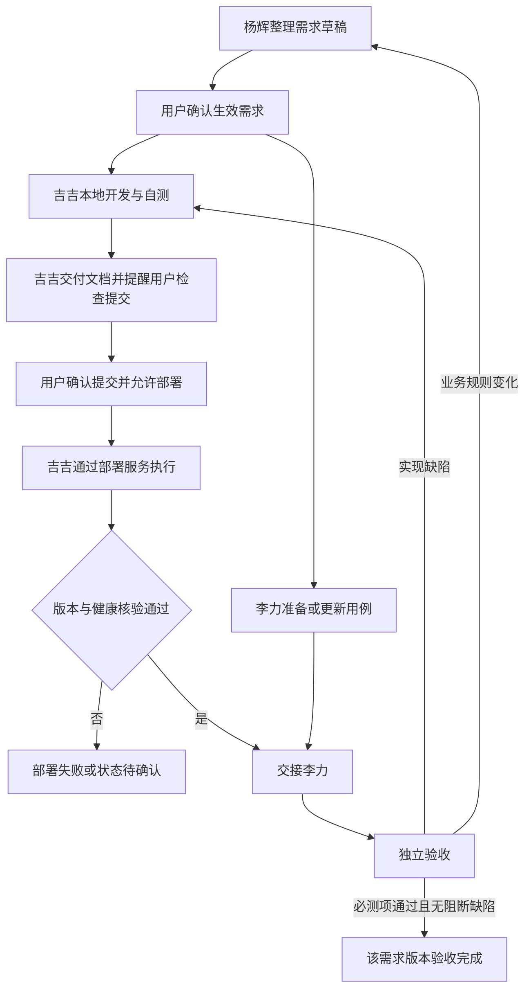
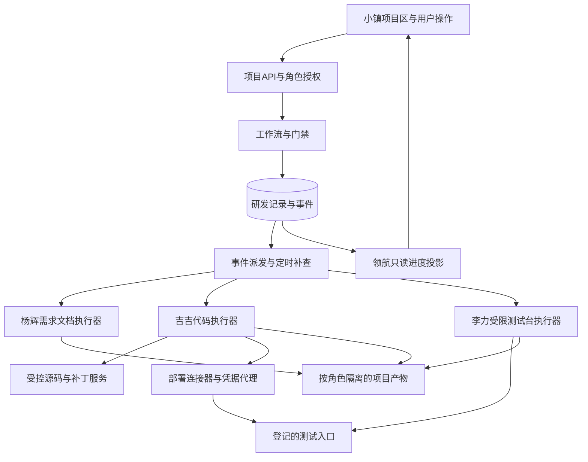

# 星栖小镇研发小队开发设计方案

> 文档版本：0.3 · 实现现状与后续设计评审稿
>
> 整理日期：2026-11-13；实现现状更新：2026-11-16
>
> 设计产品基线：星栖小镇 v1.13.0；下述研发台现状以当前源码为准，不表示变更已经发布。
>
> 文档目的：供产品、开发、测试与平台同事评估需求、权限边界、技术可行性及实施范围。
>
> 实现状态：研发台已接入项目成员、需求版本、答疑、确认、测试方案、原生源码授权、吉吉受控候选文本修改及原生确认应用；功能自测执行器、提交验证、测试部署与独立验收仍待建设。使用步骤见 [研发台使用说明](DEV_WORKBENCH.md)。

## 评审摘要

**当前可用范围截止到候选修改审查与获准本地应用，之后由用户检查并自行提交。当前实现不能称为自动研发全闭环。** 第 2 节记录已实现事实；其余各节除明确标记现状外，描述完整目标流程与后续验收要求。

在小镇中建立由**产品经理杨辉、开发工程师吉吉、测试工程师李力和领航**组成的研发小队，以一个真实业务项目中的“需求任务包”为协作主线。

杨辉负责需求与验收口径；吉吉负责本地代码实现、开发自测、文档、异常分析和获准的测试部署；李力通过项目区内的受限测试台独立验收；领航只汇总进度与阻塞。星探不参与本流程。

**用户保留代码提交、推送和部署授权权。** 吉吉完成本地修改后提醒用户检查、提交。用户点击“已提交并允许部署”，系统核验并绑定具体需求版本、提交和测试环境。吉吉确认该版本真实部署成功且健康检查通过后，通知李力开始验证。缺陷修复后再次经过用户提交与部署授权，直至当前需求版本验收通过。

实施核心不是给聊天角色增加九段提示词，而是建设可追溯的工作记录、按角色隔离的执行接口、持久化交接机制与验收门禁。技能指导工作方法，程序决定权限和状态变化。

### 结论标记

| 标记 | 含义 |
| --- | --- |
| 已确认 | 来自本次讨论并已获用户认可，实施时应保持 |
| 设计建议 | 为落实已确认目标提出的技术或交互方案，待评审确定 |
| 待决策 | 会影响权限、成本、兼容性或交付范围，需明确责任人与选择 |

## 1. 目标、范围与约束

### 1.1 已确认的产品规则

| 编号 | 规则 |
| --- | --- |
| R01 | 小队包含杨辉（产品经理）、吉吉（开发工程师）、李力（测试工程师）、领航四个角色；星探不参与本次研发流程。 |
| R02 | 领航是进度总览角色，了解当前阶段、责任人、阻塞和验收结果；无需逐项审批、分派或操作代码。 |
| R03 | 居民中只有吉吉拥有指定项目源码的读取、本地修改和测试环境部署能力。 |
| R04 | 杨辉、李力和领航只能访问获准的小镇项目区资料与工具，不能访问源码仓库、源码片段、补丁、终端或部署凭据。 |
| R05 | 吉吉完成修改后提醒用户 check 和 commit；代码提交与推送由用户完成，居民不能代为提交、推送、合并或打发布标签。 |
| R06 | 用户提交后，通过明确操作允许该版本部署测试环境；旧授权不能自动覆盖新的提交、需求版本或目标环境。 |
| R07 | 每位居民定时检查自己的职责；需求变更应让吉吉与李力及时获知并调整代码与验证安排。 |
| R08 | 采用即时事件通知与定时补查；没有新事件或待办时，轻量程序检查即可，无需持续调用模型。 |
| R09 | 吉吉核实部署成功、运行版本正确及必要健康检查通过后，才交给李力验证。 |
| R10 | 测试通过才算该需求版本测试验收完成；未通过进入修复与回归。旧报告不证明新版本已经通过。 |
| R11 | 李力通过小镇项目区的受限测试台访问登记的测试功能，保持无源码权限。 |
| R12 | 对外沟通先生成答复草稿；向前端、测试、产品等真人发送消息必须有对应渠道和发送授权。 |

用户本人是项目所有者，不受“居民中只有吉吉读代码”的角色限制。程序为核验版本、应用补丁和执行部署所进行的必要机器操作，属于吉吉能力的受控服务实现，不能因此向其他居民开放源码。

### 1.2 首期目标

1. 在一个真实项目、一个测试环境上，完成一条需求的完整开发与验收闭环。
2. 每个状态都有实际交付物或执行证据，能回答“谁在做、依据哪个版本、当前等什么”。
3. 用户控制的代码提交与部署授权不可被居民绕过。
4. 需求变化、失败重试、应用重启和重复事件不会造成重复部署或错误验收。
5. 小镇画面、任务板和居民答复使用同一份真实工作记录。

### 1.3 首期范围之外

- 自动 commit、push、merge、创建代码发布标签，或部署生产环境。
- 星探参与需求研发；给其他居民开放源码读取、任意命令行或数据库管理权限。
- 默认自动向真人发送沟通消息。
- 多租户远程协作服务、跨机器居民集群、24 小时后台守护进程。
- 所有语言、部署平台、测试框架和旧系统执行器一次性兼容。
- 通过聊天次数、动画时长或模型自述判定完成度和能力成长。

## 2. 当前能力与建设缺口

本节区分既有产品能力与当前源码新增的研发台能力。既有架构文档中的早期地图尺寸、居民数量等历史描述不作为本方案的实施依据。

### 2.1 既有能力

| 当前能力 | 实际入口 | 对本方案的意义 |
| --- | --- | --- |
| 居民资料、聊天、地图、任务板与成长册 | `server.py`、`web/app.js` | 可复用角色与展示框架，不能把普通聊天作业等同于研发执行记录。 |
| 杨辉、李力的本地角色、像素形象与职业房屋 | `defaults/residents.json`、`server.py`、`web/assets/product.svg`、`web/assets/tester.svg` | 产品经理和测试工程师已建立；研发台通过用户选择绑定已有稳定成员标识，形象与入住本身不授予源码权限。 |
| 团队工作项与报告读取 | `TownApp.records()`、现有任务板 | 保留既有外部团队台账只读模式；新增研发记录在独立研发台展示，尚未打通全部地图与旧任务板投影。 |
| 文本模型连接 | `provider_bridge.py`、`model_bridge.py` | 普通对话保留原限制；研发调用已通过独立工作记录和受控执行入口接入，不借聊天解除权限。 |
| 星探独立任务与行程 | `scout_workshop.py`、`scout_journey.py` | 可参考真实任务与动画分离的模式；本次不复用星探身份或材料库作为研发空间。 |
| 安全工作区与审计 | `town_security.py` | 可参考独立记录与脱敏方式；研发仓库不因此自动加入其他居民的扫描范围。 |
| 桌面启动、存档和系统凭据存储 | `desktop_runner.py`、`credential_store.py` | 可复用生命周期与凭据抽象；新增执行器的兼容性需独立验证。 |

### 2.2 当前源码已接入的研发台

| 能力 | 当前行为与证据入口 | 实际边界 |
| --- | --- | --- |
| 项目与小队 | `town_dev_workbench.py`、`web/dev-workspace.js` 保存项目与现有成员固定标识；导航入口为“研发台” | 不自动创建或按姓名合并居民，不因绑定项目自动授权源码。 |
| 需求分析、答疑与确认 | 原始需求按版本保存，杨辉的分析和问题入库，必答问题解决后由用户确认生效 | 分析是模型文稿；新草稿与生效版本分别保存，未确认草稿不替代原基线。 |
| 测试方案 | 李力根据获准共享资料生成版本化用例，保存在 `test_plan` 产物中 | 尚未执行用例，不能写成独立验收通过。 |
| 作业与角色资料 | 独立研发数据库保存作业、问题、产物、讨论和事件；服务调度已排队作业，空闲时等待通知并周期检查 | 普通聊天不驱动状态；当前调度不是全部九项技能的自动职责闭环，也不是应用关闭后的守护服务。 |
| 源码授权与撤销 | `town_owner_actions.py` 的 `dev-connect` 在桌面原生窗口核对项目、开发成员、指定仓库与当前 API 模型；项目提供“断开源码授权” | 断开停止后续源码访问及开发，旧候选不能再应用；不删除用户文件，不收回已发送请求。 |
| 吉吉候选修改 | `town_dev_runtime.py` 提供查找、读取、唯一片段替换、新建文本文件、提问与完成动作；新旧内容保存为私有候选记录 | 无终端、无 Git 写工具、无测试或部署命令；当前不是可执行任意程序的隔离开发环境。 |
| 本地应用 | 用户查看私有差异，通过 `dev-apply` 原生确认；再次核对当前需求、最新批次、授权和文件基线后写入 | 未自动提交；多文件应用中断可能留下部分写入，记录已写入文件与恢复文件，不自动重放。 |
| 实现反馈 | 用户反馈入讨论记录并使旧候选失效；吉吉后续开发能读取本角色反馈和适用私有候选 | “请求吉吉修改”保存返工要求，用户仍需显式启动新一批开发。 |
| 权限与预算 | 产品、测试读取共享业务资料；吉吉读取获准源码和私有成果；领航只读进度摘要；模型调用复用受控居民、端点与额度策略 | 可用普通聊天模型不等于具备受控研发能力；不因工作台接入放宽其他居民源码权限。 |

### 2.3 尚未实现的完整流程

- **真实功能自测执行器**：当前开发成果中的功能自测明确记录 `not_run`，未提供构建、测试命令或运行证明。
- **用户提交核验**：本地应用后进入 `awaiting_commit`，用户自行检查并提交；没有把提交、变更覆盖和自测适用性绑定起来的核验服务。
- **测试部署连接器**：尚无部署授权、固定提交部署、运行版本核验、健康检查及环境代次管理；相关阶段显示受阻。
- **李力独立验收连接器**：尚无受限测试台、真实用例执行、缺陷回归和机器验收门禁；测试计划与模型报告不构成通过证据。
- **完整共享发布与协作投影**：候选源码保持私有，尚未完成设计中的共享契约发布门禁、全部事件投递回执、地图与旧任务板联动。

后续仍需按第 15、16 节完成平台隔离、真实执行与恢复验收。不得从候选修改已保存、源码文本已写入或界面阶段推进推导出自测、部署或验收成功。

**禁止直接移除现有聊天入口的限制来获得执行能力。** 普通闲聊仍然只聊天；研发操作通过显式的项目任务和受控工具入口完成。

## 3. 概念与角色分工

### 3.1 核心概念

| 概念 | 定义 |
| --- | --- |
| 项目档案 | 连接一个代码仓库、模型策略、开发工作区、测试环境、测试工具和成员权限的配置。 |
| 小镇项目区 | 受访问控制的需求、契约、用例、报告和事件空间；是逻辑数据边界，地图上的位置或围墙不构成权限。 |
| 需求任务包 | 一条需求的长期记录，关联全部需求版本、开发批次、人工提交确认、部署和验收。 |
| 生效需求版本 | 经用户确认的业务规则与验收基线；草稿编辑不自动触发返工。 |
| 开发交付批次 | 吉吉针对某个生效需求版本形成的本地变更与自测成果。 |
| 部署授权 | 用户允许某个确定的版本部署到确定测试环境的记录，不是通用“允许部署”开关。 |
| 部署批次 | 一次可查询的部署执行，包含提交、产物、环境、健康检查和实际运行版本。 |
| 验收批次 | 李力针对特定需求版本、用例版本和部署批次的验证结果。 |

### 3.2 居民职责

| 角色 | 主责 | 交付物 | 周期检查内容 |
| --- | --- | --- | --- |
| 杨辉（产品经理） | 整理业务需求、疑问、范围与验收标准；维护需求变更 | 需求说明、待确认问题、验收标准、变更摘要 | 未解决业务问题、需求草稿、等待用户确认的变更 |
| 吉吉（开发工程师） | 源码理解、本地开发、自测、联调文档、实现答疑、异常定位、修复、获准部署及结果核验 | 本地变更、代码自测证据、接口契约、实现摘要、部署证据 | 新需求/变更、待修复缺陷、有效部署授权、在途部署结果 |
| 李力（测试工程师） | 整理独立验证用例，通过测试台执行、复现、提缺陷与回归 | 用例、测试证据、缺陷单、验收报告 | 需求变化、待更新用例、已验证成功的部署、待复测缺陷 |
| 领航（进度总览） | 读取各项目进度、阻塞、等待原因和已验证结果，向用户汇报 | 进度摘要与必要提醒 | 长时间等待、失败或失联、需要用户决定的事项 |

杨辉需要了解现有实现时，向吉吉提出业务问题，由吉吉输出不含源码的业务摘要。李力需要新增测试能力时，提出需求，由吉吉实现受控测试入口并按代码审查流程交付。

居民显示名称、头像和房屋不决定权限。产品经理杨辉与测试工程师李力已有独立形象和房屋，系统仍用稳定成员标识绑定职责；当前入住不开放源码、执行或验收能力。

本方案复用以下已有居民，不再把产品和测试岗位作为待创建角色：

| 居民 | 职责 | 公开默认居民 ID | 已有工作区 |
| --- | --- | --- | --- |
| 杨辉 | 产品经理 | `resident-yanghui` | 产品设计室 |
| 吉吉 | 开发工程师 | `resident-jiji` | 节拍工坊 |
| 李力 | 测试工程师 | `resident-lili` | 测试实验室 |
| 领航 | 进度总览 | `linghang` | 指挥所 |

上述 ID 来自当前本地公开配置。若旧存档中已有居民使用不同 ID，项目接入时由用户选择对应居民并保存映射，保留其原 ID、外观和聊天；不靠姓名或头像自动授予权限。杨辉先澄清需求与完成标准，李力按实际执行证据记录通过、失败和未覆盖项，吉吉继续承担研发；职责执行遵循下文的权限与门禁。

### 3.3 用户职责

- 配置项目接入、权限、允许的测试环境和模型使用范围。
- 确认存在歧义的业务取舍、需求范围及生效变更。
- 检查吉吉的本地代码与自测结果，自行提交和按部署方式需要推送代码。
- 在小镇确认要部署的提交与环境；必要时撤销尚未消费的授权。
- 对验收中的业务取舍或例外作决定。常规本地修复沿用既有范围，修复后的新部署仍需新的版本授权。

## 4. 权限与执行边界

### 4.1 权限矩阵

“可写”只针对对应角色的产物；系统状态、授权和执行事实由服务端写入，不能通过修改文档或聊天自行变更。

| 资源或动作 | 杨辉（产品） | 吉吉（开发） | 李力（测试） | 领航 | 用户 |
| --- | --- | --- | --- | --- | --- |
| 需求草稿与变更建议 | 可写 | 评论/建议 | 评论/建议 | 仅进度摘要 | 可管理 |
| 生效需求与验收标准 | 可读；提交确认请求 | 可读 | 可读 | 仅摘要 | 确认生效 |
| 指定源码与本地工作文件 | 禁止 | 按项目授权读写 | 禁止 | 禁止 | 可管理 |
| 正式仓库 Git 索引、对象、引用与配置写入 | 禁止 | 禁止 | 禁止 | 禁止 | 可管理 |
| commit / push / merge / tag | 禁止 | 禁止 | 禁止 | 禁止 | 自行操作 |
| 已发布接口契约与无源码的实现说明 | 可读/评论 | 编写候选版本，经发布门禁共享 | 可读/评论 | 仅进度摘要 | 审核/管理 |
| 开发自测命令 | 禁止 | 经受控执行器 | 禁止 | 禁止 | 可管理 |
| 用例与缺陷 | 评论 | 读取/答复 | 可写 | 仅统计和阻塞 | 可管理 |
| 测试环境接口/页面验证 | 禁止直接调用 | 受控调试 | 经受限测试台 | 禁止 | 按项目权限 |
| 测试环境日志与只读诊断数据 | 禁止原始访问 | 经受控、脱敏接口 | 仅获准测试结果 | 仅摘要 | 按项目权限 |
| 发起部署与查部署详情 | 禁止 | 需有效用户授权 | 仅接收就绪通知 | 仅状态摘要 | 授权/撤销 |
| 写入“验收通过” | 禁止 | 禁止 | 提交报告，由服务端校验 | 禁止 | 可记录业务决定，不能伪造机器检查 |
| 读取部署或 Git 凭据 | 禁止 | 禁止取得明文凭据 | 禁止 | 禁止 | 通过凭据管理配置 |

### 4.2 源码隔离与共享资料

1. 源码、补丁、原始栈信息中的源码片段和代码附件属于吉吉/用户空间，不放入其他居民的检索索引、聊天上下文或通用书架。
2. 接口地址、字段定义、请求响应示例、业务规则、脱敏测试结果属于可审核的共享契约，不等于开放源码读取。
3. 同一文件的预览、搜索、下载、缩略图、历史版本及模型检索均执行相同访问控制，不能只隐藏列表入口。
4. 每次读取校验项目成员、产物分类与角色身份；调用者传入的 `agent_id` 不能自行决定权限。
5. 其他居民、星探及现有警官不会自动获得新仓库扫描权。确需安全扫描时，由吉吉的受控工具执行，按策略共享脱敏结论；新增访问权需另行评审。

源码侧生成的说明、日志摘要与契约先进入用户/吉吉可见的候选区。居民不能通过改文件名、声明“已脱敏”或修改分类自行发布到共享区。首期建议自由文本经用户审核后共享；可自动发布的内容限于经评审的结构化字段、模板及可信转换规则。发布记录绑定候选内容散列，内容改变须重新检查；模型自检和敏感词扫描只能辅助审核，不能保证没有源码泄漏。审核批次与提醒方式见 Q12，避免每个字段单独打断用户。

### 4.3 防止居民代替用户提交代码

**当前实现差异：** 吉吉通过有限文本动作读取获准源码，并将候选新旧内容保存在私有记录中；用户通过原生确认应用修改。当前没有任意程序运行环境、构建/自测执行器或部署服务，因此尚未完成本节的完整隔离开发方案。候选存储与路径校验不应被描述成任意代码沙箱已通过验证。

完整目标建议采用“**隔离开发副本＋受控补丁应用＋独立部署服务**”：

- 吉吉在隔离工作空间读取获准源码并产生本地变更。用户实际工作目录由可信文件服务应用经过路径校验的变更；已有未提交修改须先记录并检测冲突，不覆盖用户新修改。
- 每次应用变更同时校验需求版本、执行租约和目标文件基线；新需求生效或用户修改目标文件后，旧批次不能继续自动写入。保存旧成果供比较，由当前批次重新分析并处理冲突。
- 正式仓库 `.git`、关联 worktree 的真实元数据、Git 配置和凭据不作为吉吉可写资源。居民没有 Git 写工具、用户 SSH agent、GitHub 写令牌或宿主机凭据访问能力。
- 文件服务校验真实路径、符号链接/重解析点、文件类型与项目根，拒绝写入 Git 元数据、凭据目录或跨项目位置。允许修改的项目文件范围在接入时登记，敏感执行配置变更应突出展示给用户审查。
- 构建、自测与诊断使用登记的执行配置；不向居民提供可直接操作宿主机的任意终端。测试代码和项目脚本本身仍是不可信执行内容，必须放在同样的隔离边界内。
- 部署凭据由部署服务持有，吉吉只能提交带有效授权的部署请求，不能把凭据传给开发终端或模型。

**评审必须验证的边界：** 仅禁止字符串 `git commit` 无法阻止通过其他程序修改 Git。若允许沙箱内执行任意程序，应把可证明的保证限定为“不能改变或推送用户的正式仓库历史”；沙箱中的无权威临时 Git 对象不构成用户提交，也不能作为部署授权来源。若业务要求任何临时目录内也绝对禁止构造提交，则需要更严格的受限执行模型，不能宣称普通命令黑名单能满足。

隔离方案、补丁服务与 Windows/Mac 的能力差异是首期技术验证项。能力不足时应显示明确阻塞或保留手动操作模式，不静默放宽为宿主机任意执行。

### 4.4 项目接入配置

| 配置项 | 用途 |
| --- | --- |
| 仓库标识、远端、用户工作目录、允许编辑范围 | 确定吉吉能访问哪个项目；本机路径仅保存在私有配置 |
| 初始分支/提交、已有本地改动清单 | 防止以错误基线开发或覆盖用户工作 |
| 项目成员和角色绑定 | 将已有杨辉、吉吉、李力与领航按稳定居民 ID 绑定到该项目 |
| 模型及源码使用策略 | 确认项目源码是否允许发送给所配置模型；不从普通聊天配置自动推导公司源码外发授权 |
| 开发自测配置 | 登记构建、检查、超时、资源上限与依赖来源 |
| 测试环境标识、地址、允许的接口/页面与测试账号引用 | 限定测试台访问范围；排除生产环境 |
| 部署连接器、版本识别方式、健康检查、回退方案 | 确保能验证实际运行版本并处理失败 |
| 文档模板、专业技能配置 | 复用项目规范，记录采用的技能版本 |
| 调度周期、提醒与保留策略 | 控制查询频率、模型成本和证据保存期限 |

## 5. 九个技能的设计

以下为完整目标的九项能力入口，尚未作为九个独立技能文件交付。当前已实现的需求分析、测试计划和受控候选修改详见第 2 节；不得把它们视为九项能力已全部落地。技能只有在项目与角色授予相应能力后才可调用；技能说明不能扩张权限。

| 技能 | 主要执行者 | 输入 | 必需输出 | 完成条件 |
| --- | --- | --- | --- | --- |
| 1. 需求理解 | 杨辉；源码问题由吉吉解读 | 用户材料、业务背景、既有契约 | 需求摘要、影响范围初稿、疑问清单 | 明确已知与未知，不把猜测写成业务事实 |
| 2. 需求确认 | 杨辉组织，用户确认 | 需求草稿、疑问答复 | 生效需求版本、验收标准、排除范围 | 关键业务疑问已解决且用户确认生效 |
| 3. 需求开发 | 吉吉 | 生效需求、仓库基线、开发规范 | 本地变更、实现摘要、受影响契约 | 变更可审阅，范围可追溯，进入开发自测 |
| 4. 功能自测与验证 | 吉吉开发自测；李力独立验收 | 前者使用开发副本；后者使用生效需求、用例与就绪环境 | 两种独立报告，保留执行身份和证据 | 不将吉吉自测通过替代独立验收 |
| 5. 联调测试文档 | 吉吉编写实现契约，李力补验证方法 | 已确认接口、业务逻辑、自测结果 | 接口说明、示例、异常码、联调步骤、待验证项 | 文档绑定需求与交付版本，来源可核对 |
| 6. 实现沟通 | 吉吉回答实现；杨辉/李力回答各自事项 | 提问、任务上下文、获准资料 | 答复草稿、理由、取舍、待决问题 | 解释依据明确；源码证据仅用户/吉吉可见；对外发送另依授权 |
| 7. 测试环境异常分析 | 吉吉；李力提供复现信息 | 部署版本、脱敏日志、异常现象、获准只读数据 | 根因分析、证据、不确定项、修复建议 | 区分已证实原因与假设，不只依据聊天推断 |
| 8. 反馈修正 | 吉吉；杨辉处理业务变更 | 缺陷或已确认变更、影响分析 | 新本地变更、更新文档与自测结果 | 返回等待用户检查提交，不能沿用旧提交直接部署 |
| 9. 测试环境部署 | 吉吉经部署服务执行 | 用户版本授权、远端提交或获准的不可变提交来源、环境配置 | 部署批次、产物来源、运行版本、健康证据 | 全部门禁通过才交接独立验收 |

### 5.1 技能调用约定

每次执行记录：`project_id`、`task_id`、`requirement_revision_id`、`run_id`、执行者、技能标识及版本、输入产物引用、授予能力、结果与错误原因。

模型可提交计划、产物和下一步建议；状态机校验后决定是否推进。没有实际执行回执时，输出只能标为分析或建议。

### 5.2 复用既有专业规范

| 既有技能 | 可复用方式 | 权限注意 |
| --- | --- | --- |
| `java-coding-standard` | Java 项目的开发与修复规范 | 只交由吉吉执行涉及源码的部分 |
| `delivery-doc-standard` | 适用项目的联调、自测与上线配置文档格式 | 源码提取由吉吉完成；交付共享区前检查源码与敏感信息 |
| `test-triage` | 测试环境日志、数据、代码与部署证据的联合定位 | 由吉吉在项目授权内使用；不能直接给李力整套源码/SSH能力 |
| `fortress-selftest-playbook` | 适用 Fortress 项目的需求覆盖与验证方法 | 代码分析归吉吉；李力仅使用受限环境验证能力 |

这些是可选的项目配置，不是公共小镇的必装依赖。私人业务规则、内部地址和凭据不能随开源安装包分发。项目确有金额等特殊逻辑时，再由项目配置启用相应专业规范。

`starhaven-release` 用于发布小镇自身的软件版本；它不是研发小队业务项目的测试部署技能，不得借用其中的提交、推送或发布流程突破本方案的用户提交边界。

## 6. 需求任务包与文档交接

### 6.1 任务包内容

| 区域 | 内容 | 可见范围 |
| --- | --- | --- |
| 需求 | 原始业务材料、生效版本、验收条目、业务决定 | 项目角色按权限读取；领航默认只取摘要 |
| 契约 | 接口、字段、异常约定、联调步骤、测试前置条件 | 杨辉、吉吉、李力；领航仅状态 |
| 开发 | 基线、文件变更、补丁、自测日志、代码证据 | 用户与吉吉 |
| 验证 | 用例版本、执行结果、复现记录、缺陷、验收报告 | 杨辉/吉吉/李力按需要读取，领航仅汇总 |
| 交付 | 人工提交确认、授权、部署批次、运行版本、健康状态 | 用户/吉吉详细，其他角色只获准投影 |
| 协作 | 阶段、责任人、问题、等待原因、交接与通知 | 项目成员按角色投影 |

### 6.2 交接最低要求

一次交接至少提供：项目与需求标识、生效需求版本、产物引用及摘要、待解决问题、下一责任人、允许开始工作的条件。部署后交接额外包含提交 SHA、产物摘要、部署批次、环境与健康证据。

文档中的“已完成”文字不是状态变更指令。源文件、报告和任务状态分开保存，交接使用不可变产物版本；更新文档产生新版本，旧版本继续可追溯。

## 7. 工作流与状态机

### 7.1 主流程



领航读取所有阶段的进度投影。上述流转由程序条件驱动，不增加领航逐项审批步骤。

### 7.2 主任务状态

| 状态 | 进入条件 | 下一步及门禁 |
| --- | --- | --- |
| `draft` 需求整理中 | 首次创建任务，尚无生效需求版本 | 杨辉提交需求确认请求 |
| `awaiting_requirement_confirmation` 待确认需求 | 范围和验收条目可评审 | 用户确认后生成生效版本；未确认不进入该版本开发 |
| `developing` 开发中 | 已有生效需求，吉吉取得工作租约 | 本地变更、自测和联调契约满足交付要求 |
| `awaiting_user_commit` 待用户检查提交 | 吉吉完成开发交付批次 | 用户自行检查、提交；提交来源与变更覆盖需要核验 |
| `awaiting_deployment_approval` 待用户部署授权 | 已核验用户提交，或确认新需求可复用既有提交 | 用户确认确切需求、提交和环境；不能自动创建授权 |
| `ready_to_deploy` 已获准部署 | 有效授权绑定需求、提交、环境且预检通过 | 吉吉领取唯一部署请求；起跑前再次校验授权与版本 |
| `deploying` 部署中 | 外部部署记录已创建 | 查询实际结果，成功不明时进入待确认，不能重复触发 |
| `ready_for_acceptance` 待验收 | 运行版本和健康核验通过 | 用例与需求匹配、环境版本仍正确，李力领取执行 |
| `accepting` 验收中 | 独立测试批次已建立 | 运行测试并提交证据；环境漂移则暂停/失效 |
| `rework_required` 待修复 | 验收发现阻断缺陷 | 吉吉修复后重新自测并等待用户提交 |
| `accepted` 验收完成 | 当前版本全部验收条件通过 | 新生效需求建立新的工作周期，保留旧验收记录 |
| `cancelled` 已取消 | 用户取消需求 | 停止新动作，明确处理已发出的部署/测试，不删除历史 |

另外保存 `run_status`（排队、运行、等待外部、失败、中断、成功）、`blocked_reason` 和 `next_owner`，避免用一个状态字段掩盖执行失败。阶段失败保留原阶段与原因；例如部署失败不能跳到待验收。

新需求草稿的编辑/待确认状态保存在需求修订记录中，不把已有生效版本的主任务退回 `draft`。例如 R1 正在验收而 R2 仍是草稿时，主任务继续反映 R1；只有用户激活 R2 后，主任务才切换到新工作周期。

### 7.3 需求变更规则

1. 草稿编辑只通知相关编辑者。用户确认发布新的生效版本后，产生 `requirement.activated` 事件，同时通知吉吉与李力。
2. 吉吉分析代码和契约影响，李力更新用例及回归范围；等待业务答案时明确阻塞原因。
3. 旧运行、报告、授权和部署记录保留，但不能关闭新生效需求。尚未消费的旧需求部署授权失效。
4. 新版本需要代码调整时，进入开发、自测、用户提交和新部署授权闭环。
5. 吉吉认为无需代码修改时，要记录理由和覆盖证据，李力仍更新验收依据。首期建议由用户确认这一结论；不得仅凭模型一句“无影响”直接验收。可复用经核验的用户既有提交，无需制造空提交；进入 `awaiting_deployment_approval`，以新需求版本获得新授权、建立新部署批次并重新验收。复用旧部署直接测试作为后续优化，不纳入首期默认路径。
6. 部署或测试进行中发生变更时，标记当前批次针对旧需求。可安全停止的工作停止；已经产生外部副作用的操作先查询实际结果，不能伪造取消或自动回滚。
7. 首期按“当前需求的全部验收项＋登记的基础回归”执行；后续有可靠影响关系后再缩减回归范围。影响未知时采用完整范围。

### 7.4 历史验收与当前环境分开记录

“R1 在 C1 / DEP1 上验收通过”是保留的历史事实；“测试环境当前运行哪个版本、是否仍具备该验收条件”是实时状态。后续正常部署不抹去已完成的历史验收，但界面不能把旧报告标作当前环境已验证。进行中的测试遇到环境变化则暂停并重新执行；新需求生效后，旧验收继续可查，但不代表新需求已完成。

领航同时展示“需求验收结论”和“当前环境验证状态”，避免单个绿色标记混淆这两件事。

## 8. 用户提交确认与部署授权

### 8.1 按钮交互

在“待用户检查提交”阶段显示：本地变更摘要、自测结论、文档状态、未解决问题，以及用户可打开的代码差异入口。

用户自行提交后点击“**已提交并允许部署测试环境**”。确认面板展示项目、需求版本、完整提交标识、目标环境、是否还存在未提交修改、构建/部署方式及必要的影响提示。用户明确确认后创建授权记录。

若按第 7.3 节确认无需代码修改，入口显示“确认使用现有提交并部署”，仍需展示新需求版本和既有提交，执行同样的核验与授权门禁。

### 8.2 服务端核验

- 提交来自登记仓库，能解析为完整 SHA；不能仅存分支名、用户输入的描述或可变的“最新版本”。
- 对于从远端构建的部署方式，提交必须由用户推送且远端可获取；否则返回“等待用户推送”，吉吉不代推送。
- 比较开发交付批次与用户提交后的差异，检查是否有任务变更遗漏或用户额外修改。Git 提交存在不等于需求已经正确实现；用户改动使自测证据不再对应时，吉吉需对该提交重新验证。
- 未提交内容不混入部署。若仍有属于本需求的未提交改动，先提示处理；其他明确隔离的工作不能被强制清理。
- 需求版本、项目权限、部署配置和目标环境必须仍有效。授权核验与消费使用原子状态变更，防止重复点击导致重复部署。

### 8.3 授权对象建议

```text
DeploymentApproval
  id, project_id, task_id, requirement_revision_id
  commit_sha, environment_id, deployment_profile_revision
  approved_by_user, approved_at, expires_at
  state: active | consumed | revoked | expired | superseded
  deployment_id, idempotency_key
```

有效期是待评审的项目策略。一次授权对应一个逻辑部署批次，可补查其结果；重试外部触发不得创建第二次不明部署。确认已失败后是否允许同授权重试，应在用户确认的部署策略中明确；首期建议用户对新的部署尝试重新授权。

已发出的部署不能仅凭“撤销授权”假设已停止。撤销后停止后续动作，并记录外部取消请求的实际结果。回退到旧版本也属于部署动作，首期需要明确的回退授权。

## 9. 部署核验与独立测试

### 9.1 部署连接器

设计建议首期优先接项目现有 CI/CD，提供触发、查询、获取构建来源、运行版本与健康检查的窄接口。是否支持直接部署需单独评审，不默认给吉吉 SSH 终端。

接入验证还须确认平台支持幂等触发，或能够按预先生成的客户端关联 ID 查询原请求。若两者均不支持，触发结果丢失时只能进入“状态未知、待用户核对”，不得自动重发；不能仅以具备触发/查询接口宣称可安全恢复。

部署从用户授权的不可变提交构建，记录构建 ID、产物摘要与部署 ID。开发工作目录中的未提交文件不得成为部署输入。预先构建的产物需证明来源提交与授权一致，并绑定产物摘要，不能仅依据文件名。

同一测试环境设置独占部署锁；涉及同一服务的测试期间应持有环境预约并检测环境变化。验收绑定 `environment_generation`（环境代次），由受信服务在重新部署、影响测试的配置变更或基准数据重置时更新；同一 SHA 再部署也会产生新代次。另一任务覆盖环境时，暂停并失效进行中的验收，历史验收按第 7.4 节保留。

平台外操作也须通过环境管理入口或可信观测接入代次更新；不能观测的外部变更无法获得自动验收保证。试点接入时应选择可控环境，无法满足时阻塞自动验收，记录人工核对结果与适用范围。

### 9.2 “部署成功”的判据

必须同时满足：外部部署执行成功、运行版本与授权提交/产物一致、登记的健康检查通过、测试入口可用。只有命令退出码为 0、日志出现“success”或页面能打开均不足以单独判定。

版本证据可来自受信的版本接口、部署平台的运行镜像摘要及提交映射等。项目没有可靠版本识别能力时，接入阶段需先补齐；不能静默跳过此门禁。无法自动证明的人工检查应显式显示为人工证据，自动验收能力范围相应受限。

### 9.3 测试台

李力使用结构化用例调用受限测试服务，首期建议先支持业务 API 黑盒测试，页面自动化作为后续扩展。用例包含前置数据、操作、预期结果、优先级与对应验收条目。

测试服务只允许登记的测试目标、操作和数据范围，处理跳转、解析后目标地址、账号及测试数据清理；不提供任意 URL 代理或脚本执行通道。会写入数据的用例只能操作专用测试账号/数据，明确幂等与清理方式，禁止真实收费或生产写入。

测试开始前、重要测试步骤及报告落库前复核环境版本、配置与代次；出现覆盖或基准重置时，即使提交 SHA 相同，也保留证据并将本批次标为无效/待重跑。李力不能自行宣称环境符合版本，也不能修改服务端生成的执行原始记录。

### 9.4 验收通过条件

```text
报告需求版本 == 当前生效需求版本
报告部署批次 == 本次允许验收的部署批次
运行提交/产物 == 用户授权提交/产物
报告环境代次 == 本批次预约且仍有效的环境代次
用例版本适用于该需求版本
必测项全部通过，必测项无未执行/跳过
无未解决的阻断缺陷
执行证据完整，报告写入时环境版本仍有效
```

服务端基于以上条件生成验收状态。非阻断事项可记录后续计划；任何例外须明确由用户决定，显示为“带例外接受”等独立结论，不能伪装成全部测试通过。

## 10. 事件、定时职责与恢复

### 10.1 推荐事件

| 事件 | 主要接收方 | 后续动作 |
| --- | --- | --- |
| `requirement.activated` | 吉吉、李力 | 代码影响分析、用例更新 |
| `development.ready_for_review` | 用户提醒，领航摘要 | 等待用户检查提交 |
| `deployment.approved` | 吉吉 | 消费授权，发起确定版本部署 |
| `deployment.verified` | 李力 | 准备执行该批次验收 |
| `deployment.failed_or_unknown` | 吉吉、用户提醒 | 定位或查询状态，停止验收推进 |
| `acceptance.failed` | 吉吉，杨辉按问题类型参与 | 修复缺陷或澄清业务规则 |
| `acceptance.passed` | 用户、杨辉，领航摘要 | 记录该版本验收完成 |
| `run.blocked` / `run.recovered` | 当前责任人，领航摘要 | 处理阻塞、恢复工作 |

### 10.2 调度建议（待评审参数）

- 事件落库后立即唤醒对应职责；每 30 秒轻量扫描未处理事件、到期检查和在途外部任务。
- 外部部署查询按平台能力退避，例如 10 秒逐步增至 60 秒，并设置超时和速率限制。
- 领航按变更汇总；只有新增阻塞、需要用户操作或阶段完成才提醒，避免每轮发送同样消息。
- 杨辉和李力可并行整理需求、用例；首期同一代码工作区只允许一个吉吉写任务，同一环境只允许一个部署批次。
- 模型执行设置轮次、时间、调用费用预算与取消入口；达到上限记为阻塞并保留成果，不无限重试。

周期是应用内部调度策略，不是为每个居民创建无限运行的聊天。事件队列负责工作，动画和浏览器轮询不负责发起任务。

### 10.3 持久化与幂等

主状态变更和待通知事件在同一数据库事务写入。采用至少一次投递，消费者使用事件 ID、接收角色、处理动作与需求版本去重，不宣称消息天然只投递一次。

执行记录采用租约、心跳和带版本号的状态更新。租约失效后先核实原任务是否仍在执行；仅租约超时不证明外部部署失败。调用外部平台前先持久化稳定幂等键、客户端关联 ID 和执行意图，再记录返回的平台任务 ID。响应丢失时按平台任务 ID 或客户端关联 ID 查询原任务，不重新创建部署；平台不能识别原请求时按第 9.1 节转人工核对。

通知失败可以补发，不能为补通知再次部署。迟到的回调必须核对 `run_id`、需求版本、提交与部署批次，写入对应历史记录，不覆盖当前版本状态。

### 10.4 关闭、重启与离线

设计建议首期只在桌面应用运行时调度。退出时停止领取新工作，保存执行检查点；本地任务取消或标记中断，远端已开始的部署可能继续运行。重启后先查询既有部署/测试状态并对账，再恢复后续阶段，不自动重复部署。

断网或凭据失效显示“状态未确认/等待恢复”。恢复连接后校验实际版本和运行记录。后续若需要关闭小镇后继续工作，应另建显式启用的后台服务并评审生命周期，不能依赖页面动画存活。

## 11. 数据模型建议

新增研发业务独立 SQLite 数据库，建议位于用户数据目录的 `development-squad/` 下。沿用现有聊天库保存居民，不把研发执行塞入现有聊天 `jobs` 表。

| 实体 | 关键字段与用途 |
| --- | --- |
| `projects` | 项目标识、公开显示名、配置版本、启用状态；真实目录与凭据引用保存在私有配置 |
| `project_members` | 项目、居民稳定 ID、角色、授权策略版本 |
| `requirements` / `requirement_revisions` | 需求逻辑标识、当前生效版本、草稿/生效状态、验收条目及确认者 |
| `work_items` | 需求任务、当前阶段、当前版本、责任人、阻塞、乐观锁版本 |
| `development_deliveries` | 基线、交付批次、本地差异摘要、变更证据、自测报告、用户提交核对结果 |
| `artifacts` / `artifact_versions` | 文档、用例、报告引用、摘要、内容散列、敏感等级和访问策略 |
| `runs` | 技能、执行者、输入版本、能力集合、状态、租约、外部任务 ID、预算与错误 |
| `deployment_approvals` | 用户授权、需求/提交/环境/配置绑定、消费/撤销/过期状态 |
| `deployments` | 授权、提交、产物、环境、外部执行记录、实际版本与健康证据 |
| `environments` / `environment_reservations` | 环境代次、部署/配置/基准变更、占用者、租约及适用的测试批次 |
| `test_cases` / `test_runs` | 验收条目映射、用例版本、部署批次、环境代次、执行结果及报告 |
| `defects` | 复现步骤、预期/实际、版本、严重度、证据、修复与复测记录 |
| `events` / `event_deliveries` | 持久事件、去重键、接收角色、确认时间与重试次数 |
| `audit_records` | 身份、动作、对象、授权依据、时间、结果和脱敏关联信息 |

### 11.1 不变量

- 所有业务记录带 `project_id`，跨项目引用在服务端拒绝。
- 生效需求、已确认授权、执行事实与测试原始结果不能被居民通过普通文件接口覆盖。
- 同一授权只能关联一个逻辑部署批次；同一事件处理动作有唯一键。
- 同一任务当前版本的变更采用比较并更新，避免旧执行器覆盖新状态。
- 验收通过必须引用存在且符合版本关系的部署、自测/用例和执行证据。
- 正文、凭据、原始源码与完整请求内容不写入通用审计；源码产物不进入领航摘要。

## 12. 服务架构与接口建议



### 12.1 模块边界

| 拟建模块 | 职责 |
| --- | --- |
| `development_squad` | 项目、成员、任务包及生命周期 |
| `development_workflow` | 状态转移、门禁、版本失效和验收计算 |
| `development_policy` | 角色能力、资源分类、路径与目标环境限制 |
| `development_scheduler` | 事件队列、职责补查、租约、幂等与恢复 |
| `development_artifacts` | 需求、契约、报告的版本管理和访问投影 |
| `development_executors` | 模型/编程执行器、受限测试台、部署平台的适配接口 |
| `web/development-workspace` | 项目区、职责待办、人工提交确认、部署/验收详情 |

模块名为设计建议。优先遵循现有 Python 服务与网页组织方式，执行器按能力单独接入；不预设必须迁移整个应用框架。

### 12.2 关键接口草案

以下仅为评审契约，不是已存在的 API。外部输入的身份字段不能作为授权依据。

| 接口/动作 | 调用身份 | 核心校验 |
| --- | --- | --- |
| 创建/配置项目 | 用户 | 目录、环境、能力探测、模型数据策略 |
| 创建需求草稿、提交确认请求 | 杨辉/用户 | 成员、版本、验收条目 |
| 激活需求版本 | 用户 | 当前草稿版本、确认记录，原子发出变更事件 |
| 获取角色任务上下文 | 各角色 | 仅返回角色获准的产物及状态投影 |
| 发布共享契约或说明 | 用户审核入口/受信转换服务 | 候选内容散列、发布策略、敏感分类及审核记录；居民不可自行降级 |
| 写本地变更、执行开发检查 | 吉吉执行身份 | 项目范围、写租约、工作区基线、命令配置 |
| 核对用户提交、创建部署授权 | 用户操作，经吉吉版本服务核验 | 完整 SHA、变更覆盖、自测适用性、环境与当前需求 |
| 请求部署、查询部署 | 吉吉执行身份 | 有效授权、幂等键、环境锁、固定提交 |
| 提交部署核验回执 | 受信连接器 | 执行 ID、身份签名/通道、实际版本与健康证据 |
| 创建测试运行、读取测试结果 | 李力执行身份 | 对应部署已就绪、用例版本、环境预约与允许操作 |
| 提交验收报告 | 李力执行身份 | 证据完整、版本一致、必测项与缺陷门禁 |
| 查看进度、阻塞和提醒 | 领航/用户 | 只读投影；无隐含执行能力 |

每个会产生执行副作用的请求携带幂等键和预期任务版本。异步结果返回执行 ID，状态通过查询或事件更新；网络超时不应直接等同于失败。

## 13. 小镇交互与像素表现

### 13.1 项目区页面

项目总览显示需求列表、当前阶段、责任人、阻塞原因、等待时间、最近成果与验收状态。详情沿时间线展示需求确认、开发交付、用户提交、部署和验收；用户可以进入相应证据。

进度优先显示“当前阶段＋已验证验收项/总验收项＋阻塞”，有明确计算依据才显示百分比。领航默认只看这一层汇总，不浏览源码或全部文档。

### 13.2 房屋与道具

| 场所 | 视觉表达 | 实际对象 |
| --- | --- | --- |
| 杨辉的产品设计室 | 沿用需求板与草图桌，接入需求书架 | 需求草稿、生效版本和验收条目 |
| 吉吉的节拍工坊 | 开发工具台、待加工材料箱、交付箱 | 已授权技能、本地开发批次与文档交付 |
| 李力的测试实验室 | 沿用检查台与待复测箱，接入缺陷板和验收档案 | 用例执行、缺陷和版本化报告 |
| 领航的指挥所 | 总进度板和阻塞提醒 | 只读状态投影 |

工具架代表可用技能；书本代表文档；交付箱代表真实产物集合。不同敏感等级的产物分别呈现，不能靠居民“搬到另一座房子”改变访问权限。

### 13.3 动画真实性

居民开始工作、等待、交接和返程由实际事件驱动。动画可按合适速度独立播放，执行状态不等待动画完成；暂停动画不暂停作业，关闭页面不视为作业完成。任务失败、断联或等待用户时，显示对应状态与原因。

只有服务端产物确已保存才生成可点击交付物；不能为了热闹生成虚假的代码、测试通过或部署成果。其他居民仍可按小镇视觉规则活动，地图移动不授予研发资源访问权。

## 14. 端到端示例

示例需求：“为业务系统增加用户标签查询功能”。以下均为演示标识，不指向真实客户、项目地址或凭据。

1. 杨辉整理查询条件、权限、分页、空结果和异常场景，用户确认需求 `R1`。
2. 吉吉阅读指定仓库并本地实现；李力在项目区根据 `R1` 编写黑盒用例。
3. 吉吉完成开发自测与接口文档，生成开发交付 `D1`，提醒用户检查和提交。
4. 用户检查后自行提交、按部署方式需要推送提交 `C1`，在小镇确认“R1 / C1 / test-a”部署授权。
5. 吉吉触发部署 `DEP1`，查到服务运行 `C1` 且健康检查通过，发送就绪事件。
6. 李力创建 `T1`，发现分页边界缺陷，提交带复现证据的缺陷单。
7. 吉吉本地修复、自测、更新文档，返回等待用户提交。用户生成 `C2` 并新授权部署。
8. `DEP2` 的版本和健康核验通过后，李力重新验证需求及基础回归，生成 `T2` 并通过服务端验收门禁。
9. 领航汇报“R1 已通过验收，测试环境当前为 C2”，并提供验收报告入口。

若杨辉在第 6 步发布经用户确认的 `R2`，则 `T1`、`DEP1` 继续保留为 R1 历史记录；即使迟到的 T1 回调为通过，也不能把 R2 标为完成。

## 15. 实施阶段与交付门槛

**2026-11-16 当前进度：** 已接入 P1 的工作簿基础及 P2 中的受控候选编辑、人工审查与确认应用。P1 的全部事件/权限验收、P0 的完整平台验证与 P2 的真实自测和提交核验仍不能标记整体完成；P3 未接入。下表继续作为完整阶段的退出条件，不以局部功能可操作代替验收。

| 阶段 | 建设内容 | 退出条件 |
| --- | --- | --- |
| P0 技术与权限验证 | 选一个试点项目；验证源码隔离、补丁应用、Git写隔离、测试台目标限制、部署版本识别 | 关键权限绕过用例通过；明确支持平台与执行器；版本识别可用 |
| P1 项目与协作基础 | 项目档案、已有杨辉/吉吉/李力/领航的角色绑定、需求版本、任务包、领航只读投影、事件和定时职责框架 | 无执行工具也能以真实文档与事件完成需求确认和交接；各角色查询被正确限制 |
| P2 本地开发闭环 | 吉吉开发、自测、文档、用户待提交提醒、版本核对 | 吉吉只能产生本地变更；用户可检查提交；杨辉/李力无法读取源码 |
| P3 部署与独立验收 | 用户部署授权、一个CI/CD连接器、版本/健康核验、API测试台、缺陷回流 | 一个真实需求完成“用户提交→部署→独立验收→修复再验收”闭环 |
| P4 恢复与体验完善 | 故障恢复、重复事件处理、环境漂移、审计、像素反馈、更多测试工具 | 下列核心验收场景通过，用户可以定位问题并恢复任务 |

P0/P1 可用合成数据演示，但必须标识演示。**P3 并通过相关恢复验收后，才可以对外称为可执行的研发小队。** 不将仅能聊天、写需求文档或播放动画的阶段描述为全流程自动研发。

工作量与工期在 P0 明确执行器、测试框架和部署平台后估算；本文不把尚未选型的技术工作承诺为固定天数。

## 16. 验收场景

| 编号 | 场景 | 预期结果 |
| --- | --- | --- |
| A01 | 杨辉、李力、领航请求读取仓库文件、补丁或代码附件 | 全部入口拒绝，搜索/预览/下载同样受限，保留脱敏拒绝记录 |
| A02 | 吉吉尝试写正式仓库.git、经符号链接/重解析点逃逸、调用替代Git实现或宿主凭据 | 正式仓库元数据与远端均不发生写入；隔离失败阻断试点 |
| A03 | 吉吉完成代码开发 | 仅本地工作文件发生预期变化，提示用户检查提交，不自动commit/push |
| A04 | 用户还有原有未提交修改，或在吉吉工作时修改相同文件 | 不覆盖或清理用户工作；检测冲突并等待处理 |
| A05 | 远端构建方式下，用户点击已提交但提交尚未推送 | 不部署，明确显示等待用户推送 |
| A06 | 提交遗漏本次部分改动，或用户额外修改使自测失效 | 指出不匹配，补充核对与自测后才能进入部署 |
| A07 | 重复点击授权、重复事件，或平台已触发但响应在任务ID落库前丢失 | 根据预存关联ID/平台幂等能力对账，不产生重复部署；无反查能力则保持未知并转人工核对 |
| A08 | 尝试使用旧授权部署新提交、新环境或新生效需求 | 拒绝，要求相应版本的新授权 |
| A09 | 部署命令成功但运行仍是旧版本，或健康检查失败 | 不通知开始验收，显示失败或版本不一致证据 |
| A10 | 部署成功后向李力发送交接通知失败 | 定时补发交接，不再次部署 |
| A11 | 测试前/期间被其他版本覆盖、同SHA重新部署、影响测试的配置变更或基准数据重置 | 环境代次变化，原验收暂停或失效，旧结果不能标为当前环境通过 |
| A12 | 开发、部署、测试中发生新需求生效 | 吉吉与李力都收到变更；旧批次保留但不关闭新版本 |
| A13 | 旧批次成功回调晚到 | 只更新对应历史批次，不覆盖当前任务状态 |
| A14 | 李力发现缺陷，吉吉修复 | 返回等待用户检查提交，不自动沿用旧授权部署 |
| A15 | 应用退出、执行器崩溃、恢复后重复领取任务 | 对账并恢复已有执行，不双重写工作区，不重复触发部署 |
| A16 | 李力请求未登记目标、生产地址、任意脚本或越界测试数据 | 测试台拒绝，不泄露凭据、不造成目标外副作用 |
| A17 | 领航通过聊天要求部署或修改验收结果 | 权限层拒绝，仍可读取正常进度摘要 |
| A18 | 必测项跳过、缺证据、仍有阻断缺陷 | 验收不通过；用户例外决定独立记录，不能伪造全部通过 |
| A19 | 连接失效、取消/撤销发生在外部部署已开始之后 | 显示实际外部状态，不把撤销本地记录当作部署已撤回 |
| A20 | 没有新事件时运行周期职责检查 | 不重复调用模型、不重复通知、不重复创建执行任务 |
| A21 | 架构或平台无法提供所要求的隔离能力 | 能力探测阻断相关执行，说明限制，不自动降权为宿主终端 |
| A22 | 查看普通聊天、星探、既有安全工作区和旧存档 | 原有功能与数据保留；新研发权限不向其他居民扩散 |
| A23 | 请求对外发送沟通草稿 | 未获对应发送授权时只保存草稿，不发送消息 |
| A24 | 全部验收条件满足 | 服务端生成当前版本验收完成状态，领航摘要、任务板和动画一致 |
| A25 | 吉吉把源码片段写入候选契约或自行将其标记为共享 | 未经可信发布门禁不得被其他居民读取，不能仅依模型自检放行 |
| A26 | R1开发/验收期间创建R2草稿但未激活 | R1继续原流程；只有R2生效才切换任务版本并处理旧批次 |
| A27 | 新生效需求经核验和用户确认无需代码修改 | 复用既有用户提交，不创建空提交；获得新授权并完成新部署/验收 |
| A28 | R1已经验收后，环境正常部署了其他任务的版本 | 保留R1历史结论；当前环境验证状态重新计算，不显示旧报告证明新环境通过 |

权限测试应验证真实文件与网络效果，不只断言提示词中包含“禁止”。部署与测试连接器需在隔离测试环境验收，不能用真实生产环境或收费操作替代测试。

## 17. 兼容、迁移与维护

- 新功能默认关闭；用户创建项目并完成接入检查后启用，不为现有吉吉或其他角色静默追加代码权限。
- 复用已有杨辉、李力、吉吉和领航的居民记录，保留 ID、外观、地块与聊天。项目接入只绑定角色与授权，不重复创建居民；同名但 ID 不同的居民由用户明确选择，不按姓名合并或覆盖。
- 新研发数据库有独立schema版本与备份迁移策略；迁移失败不删除重建现有聊天或研发记录。
- 项目配置、源码快照、需求、测试数据、凭据、日志及审计均为本地私有数据，不进入开源仓库、默认居民包或软件发布附件。
- Mac和Windows桌面可运行不代表所有编程/部署执行器均可运行。Windows 10 `17763.379` 的执行器、隔离机制、依赖和测试台须单独验收；不可沿用桌面打包成功作为证明。
- 项目区数据保留、报告归档和模型上下文裁剪采用明确策略；删除项目先停用并说明文件处理范围，不删除用户源码仓库。
- 技能版本和项目配置版本随执行记录保存。升级技能只影响后续新执行，不把旧验收解释成使用了新规范。

## 18. 待评审决策与建议责任人

| 编号 | 待决策项 | 当前建议 | 建议评审人 |
| --- | --- | --- | --- |
| Q01 | 首个试点项目和语言 | 一个真实但范围小、可独立验收的需求，优先已有自测与测试环境的项目 | 用户、开发、测试 |
| Q02 | 源码执行隔离技术与支持平台 | 先做能力验证；隔离副本、正式Git只读、受控补丁应用；不开放宿主任意终端 | 开发、平台/安全 |
| Q03 | Git禁止范围的可证明定义 | 正式仓库提交/推送只由用户完成；如要求沙箱内也禁任意Git对象生成，采用更受限执行模型 | 用户、平台/安全 |
| Q04 | 部署平台、提交来源与版本识别 | 优先现有CI/CD；远端固定SHA；可验证运行版本和产物来源 | 开发、运维/平台 |
| Q05 | 独立测试工具及数据隔离 | 首期API黑盒测试、专用账号与测试数据；页面自动化后续接入 | 测试、开发 |
| Q06 | 需求无代码影响、非阻断缺陷和验收例外 | 明确用户确认入口，保留普通通过与例外接受的区别 | 用户、产品、测试 |
| Q07 | 授权有效期、失败重试与回退规则 | 单次逻辑部署授权；新尝试或回退需明确授权，禁止无限重试 | 用户、运维/平台 |
| Q08 | 共享环境预约与并发任务 | 首期单代码写任务、单环境部署/验收预约；版本漂移使验收失效 | 开发、测试、平台 |
| Q09 | 调度与通知参数 | 应用运行时事件驱动＋约30秒补查；按变化提醒，设置模型预算 | 用户、产品、开发 |
| Q10 | 项目数据发往模型的范围 | 项目级配置与公司规则一致，源码与部署凭据分离，其他角色不接收源码 | 用户、平台/安全 |
| Q11 | 既有居民工作区如何接入研发任务 | 复用杨辉的产品设计室、李力的测试实验室和吉吉的节拍工坊，评审任务入口、状态与交付物展示；领航只看进度 | 用户、产品、美术 |
| Q12 | 源码侧说明如何发布到共享项目区 | 首期自由文本由用户批量审核，结构化自动发布限定可信模板；评估审核成本与信息隔离效果 | 用户、开发、平台/安全 |

建议同事先评审 R01–R12 是否完整体现业务要求，再评审 Q02–Q05 的可实现性，最后按第16节验收场景确定首期工作量。方案调整需记录修改原因与受影响规则，避免把权限缩减或流程变化隐藏在技术实现中。

## 19. 评审意见记录模板

| 事项/章节 | 评审意见 | 是否阻断首期 | 处理方案 | 责任人 | 结论/日期 |
| --- | --- | --- | --- | --- | --- |
| 待填写 |  |  |  |  |  |

## 20. 相关项目资料

- [研发台使用说明](DEV_WORKBENCH.md)：当前源码支持的操作、授权、草稿与生效版本、应用恢复和未接入能力。
- [居民说明](RESIDENTS.md)与[初始居民配置](../defaults/residents.json)：核对杨辉、吉吉、李力的角色及已有住处；领航的默认档案在 `server.py`。
- [项目架构](ARCHITECTURE.md)：理解现有聊天、数据和桌面运行结构；其中历史地图描述以当前源码为准。
- [贡献规范](../CONTRIBUTING.md)：项目开发和数据保护约定。
- [Windows说明](WINDOWS.md)：现有桌面依赖与旧系统验证边界。
- [小镇发布手册](RELEASING.md)：用于小镇自身版本发布，与本方案业务项目测试部署分开。
- [1.13.0更新说明](UPDATE_1.13.0.md)：本方案所依据的已发布产品基线。
